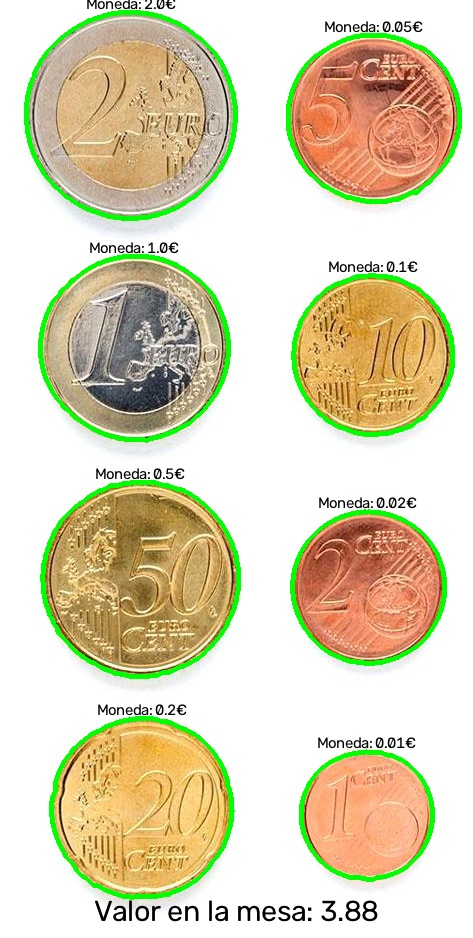
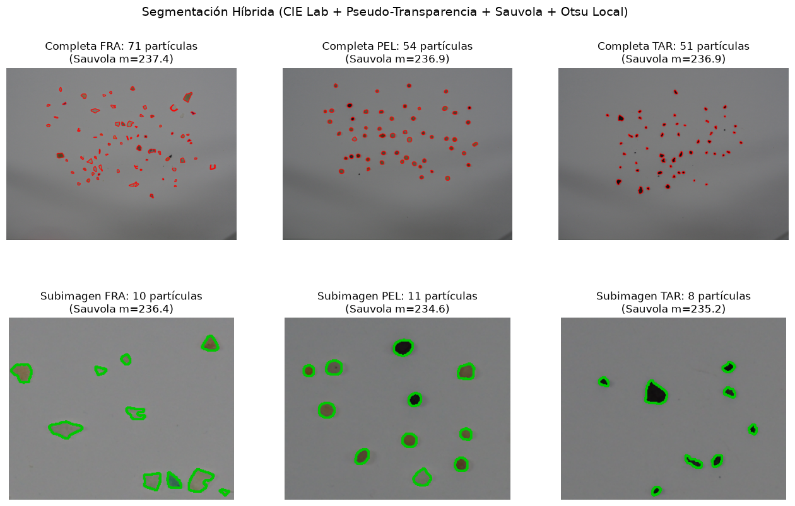
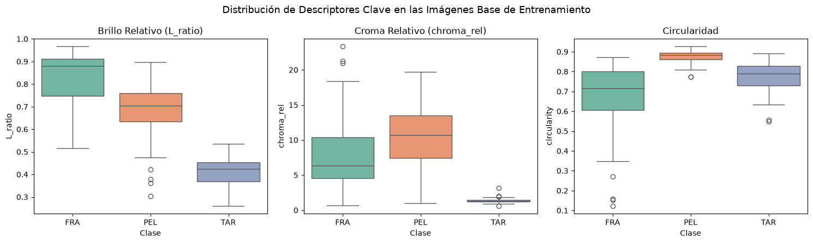
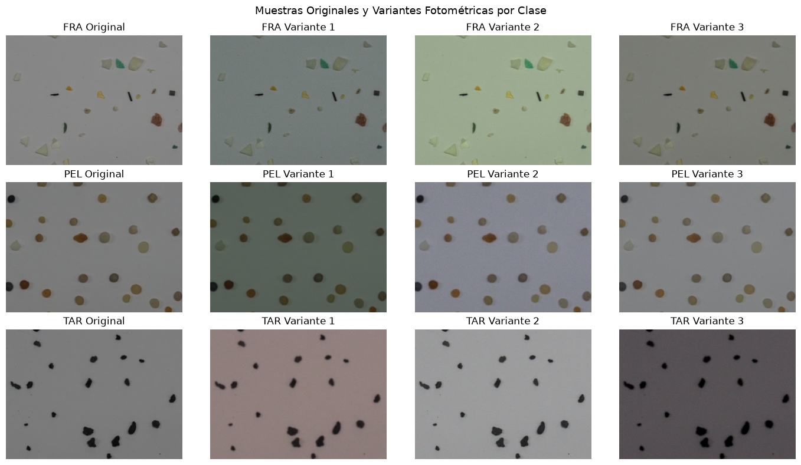
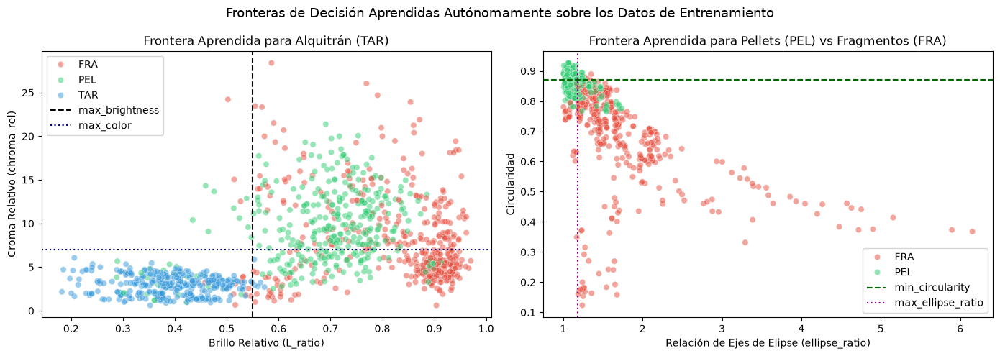
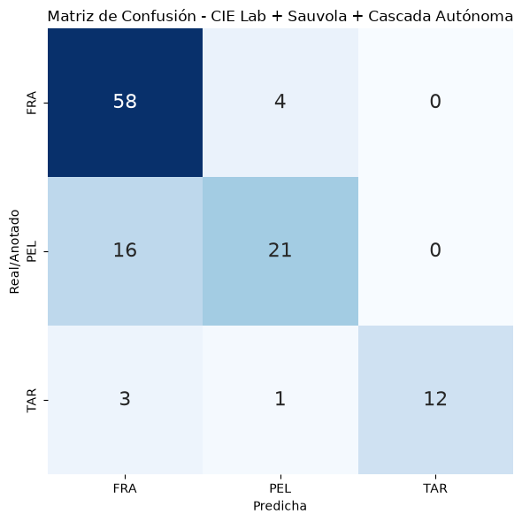
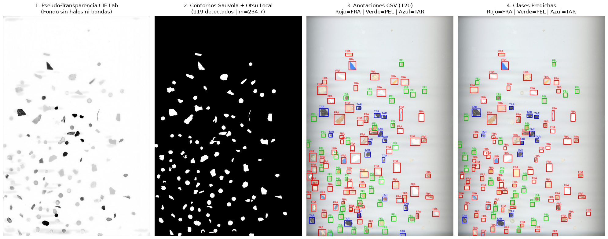
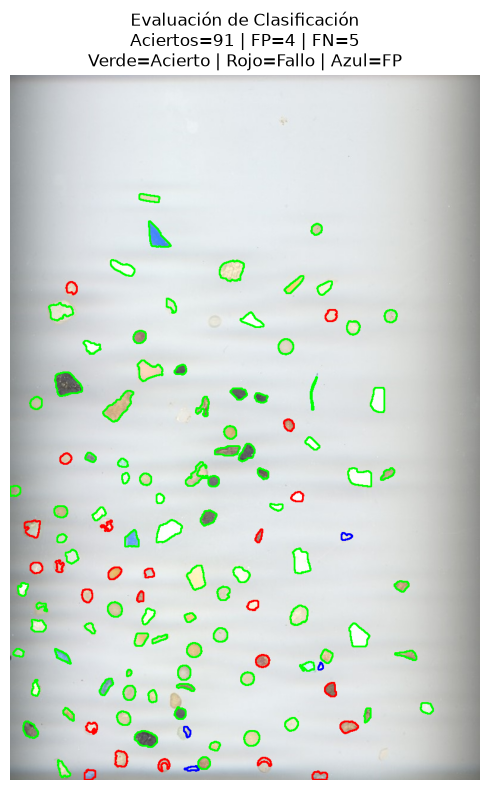
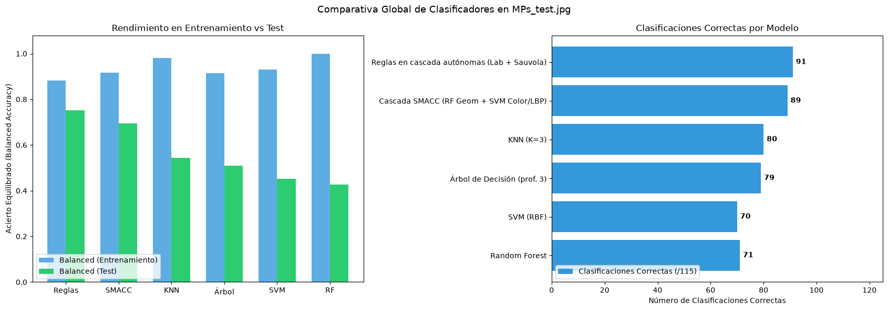

# Autores
[Ubay Antonio Batista Santana](https://github.com/UbayBatista)<br>
[Ángel Sergio Reyes Guedes](https://github.com/asergiorg)

# Trabajo desempeñado
## Tarea 1

Para el desarrollo de esta tarea, se ha dividido el proceso de captura de monedas en dos subproblemas: el primero, es obtener una aproximación del tamaño al que equivale cada píxel; el segundo, es obtener el tamaño de la moneda y seleccionar la que corresponda con esta aproximación.

Para solucionar el primer problema se han utilizado dos funciones comunes que se usan para ambos problemas. La primera permite extraer los contornos, segmentando a partir de la distancia al fondo en el espacio L\*a\*b*. Solución por la que se optó para evitar problemas al transformar la imagen a blanco y negro, por los cambios de intensidad provocados por el viñeteo de la cámara o de la propia iluminación:

~~~python
def segment(frame):
    # 1. Desenfoque para reducir el ruido de croma
    blurred = cv2.GaussianBlur(frame, (5, 5), 0)

    # 2. Lab en uint8 -> float32 para poder restar con signo
    lab = cv2.cvtColor(blurred, cv2.COLOR_BGR2LAB).astype(np.float32)
    l = lab[:, :, 0]
    a = lab[:, :, 1]
    b = lab[:, :, 2]

    # 3. Color del fondo: mediana de a y b en la franja de borde
    border = np.zeros(a.shape, dtype=bool)
    border[:BORDER_PX, :] = True
    border[-BORDER_PX:, :] = True
    border[:, :BORDER_PX] = True
    border[:, -BORDER_PX:] = True
    l_bg = np.median(l[border])
    a_bg = np.median(a[border])
    b_bg = np.median(b[border])

    # 4. Distancia de crominancia al fondo
    dist_chroma = cv2.magnitude(a - a_bg, b - b_bg)
    dist_l = np.maximum(np.abs(l - l_bg) - L_DEADZONE, 0) * L_WEIGHT
    dist = np.maximum(dist_chroma, dist_l)

    # 5. Escalado con rango fijo a uint8
    dist_u8 = np.clip(dist * (255.0 / DIST_MAX), 0, 255).astype(np.uint8)

    # 6. Si no hay señal suficiente, devolvemos máscara vacía (evita segmentar ruido)
    if np.percentile(dist, 99.5) < MIN_SIGNAL:
        return np.zeros(a.shape, dtype=np.uint8), dist_u8

    # 7. Otsu con objetos en blanco (sin INV)
    _, binary = cv2.threshold(dist_u8, 0, 255, cv2.THRESH_BINARY + cv2.THRESH_OTSU)

    # 8. Cierre para rellenar huecos (logo, parte plateada) y apertura para quitar motas
    binary = cv2.morphologyEx(binary, cv2.MORPH_CLOSE, CLOSE_KERNEL)
    binary = cv2.morphologyEx(binary, cv2.MORPH_OPEN, OPEN_KERNEL)

    return binary, dist_u8
~~~
Una vez obtenida la imagen binarizada, se calculan los contornos, a partir de la función `cv2.findContours(binarized_image, cv2.RETR_EXTERNAL, cv2.CHAIN_APPROX_SIMPLE)`, y se calcula la transformada de la distancia, para hallar la distancia al borde de los objetos desde su centro. Esto se hace con las siguientes funciones:

~~~python
def create_countour_elements(binary_image, index):
    # Creamos una máscara para el contorno actual y calculamos el valor máximo de la transformada de distancia dentro de esa máscara
    mask = np.zeros(binary_image.shape, dtype=np.uint8)
    cv2.drawContours(mask, contours, index, 255, thickness=-1)
    distance_image = cv2.distanceTransform(mask, cv2.DIST_L2, 5)

    return mask, distance_image

def find_distance_from_center_px(contour, binary_image, index):
    # Eliminamos ruido de contornos pequeños
    if cv2.contourArea(contour) < 100:
        return None

    mask, distance_image = create_countour_elements(binary_image, index)

    _, distance_from_center, _, _ = cv2.minMaxLoc(distance_image, mask=mask)

    return distance_from_center
~~~
 
Estas funciones se llaman desde la de calibración, en la que se almacenan en el buffer las estimaciones del tamaño del píxel:

~~~python
def calibrate(contours, binary_image):
    for index, contour in enumerate(contours):
        distance = find_distance_from_center_px(contour, binary_image, index)

        if distance:
            # Calculamos el tamaño de pixel a partir del radio de referencia y lo añadimos al buffer
            pixel_size_buffer.append(REFERENCE_OBJECT_MM / distance)
~~~

Una vez se tienen los valores de la aproximación en el buffer, se utiliza la mediana para obtener un tamaño de píxel con la aproximación más fiel posible:

~~~python
        # Calibramos el fondo durante los primeros segundos
        if time.time() - start_time < CALIBRATION_SS:
            # Leemos el radio del contorno de referencia y establecemos un tamaño de pixel
            calibrate(contours, binarized_image)

            # Calculamos el tamaño de pixel a partir de la mediana de las lecturas previas
            pixel_size = np.median(pixel_size_buffer)

            # Mostramos los fotogramas para aportar feedback visual al usuario
            cv2.imshow('Fotograma', bgr_frame)

            # Detenemos pulsando ESC
            if cv2.waitKey(20) == 27:
                break

            continue
~~~

Para solucionar el problema de clasificación de las monedas, si la calibración ha sido exitosa, se usan funciones que extraen el color de las monedas para clasificarlas en los grupos `bronce`, `dorado` y `bicolor`. Una vez separadas, se usa el radio para buscar la moneda que mejor encaja en el grupo correspondiente. Si se aleja demasiado de los radios, se descarta:

~~~python
def meassure_color(hsv, mask, dist_img, max_val):
    # Píxeles lejos del borde
    center = ((dist_img > 0.75 * max_val) & (mask > 0)).astype(np.uint8) * 255
    # Píxeles cerca del borde, pero sin tocarlo
    ring = ((dist_img > 0.08 * max_val) & (dist_img < 0.40 * max_val)
              & (mask > 0)).astype(np.uint8) * 255

    h_c, s_c, _, _ = cv2.mean(hsv, mask=center)
    h_r, s_r, _, _ = cv2.mean(hsv, mask=ring)
    return (h_c, s_c), (h_r, s_r)

def classify_group(centro, anillo, umbral_bimetal=12):
    (h_c, s_c), (h_r, s_r) = centro, anillo

    # Monedas con dos tonos (1€ y 2€) tienen un umbral de diferencia de tono más alto
    if abs(h_c - h_r) > umbral_bimetal or abs(s_c - s_r) > 40:
        return 'bimetal'

    # Monedas de un solo tono se clasifican en cobre o dorado según el valor medio del tono
    h = (h_c + h_r) / 2
    return 'cobre' if h < H_LIMITE else 'dorado'

def classify(radius, group):
    # Buscamos la moneda más cercana al radio medido para el grupo determinado
    key = min(MONEY[group], key=lambda k: abs(k - radius))
    if abs(key - radius) > TOLERANCE_MM:
        return None          # no encaja con ninguna moneda del grupo
    return MONEY[group][key]
~~~

### Añadido a la tarea

Como parte extra de esta tarea, se ha modificado el código anterior para permitir el cálculo de monedas y billetes simultáneamente. Para ello, se ha añadido al diccionario de dinero las medidas de las dimensiones de los billetes como clave y sus valores asociados en el grupo `billete`, y se crearon las siguientes funciones, con el fin de identificar el billete en base a su tamaño (se ha usado la relación de aspecto para evitar la lectura de elementos que no son billetes):

~~~python
def classify_bill(short, long, group):
    # Buscamos el billete cuyo tamaño sea el más cercano al del contorno detectado
    key = min(MONEY[group], key=lambda k: abs(k[0] - short + k[1] - long))
    if abs(key[0] - short) > TOLERANCE_BILL_MM[0] and abs(key[1] - long) > TOLERANCE_BILL_MM[1]:
        return None          # no encaja con ningún billete
    return MONEY[group][key]

def get_bill_shape(contour):
    # Obtenemos el ancho y largo del contorno del billete
    _, (w, h), _ = cv2.minAreaRect(contour)

    # Ordenamos w y h para obtener siempre el mismo orden, sin importar el ángulo
    short_px, long_px = sorted((w, h))

    # Conversión a mm con la escala de la calibración
    short_mm = short_px * pixel_size
    long_mm = long_px * pixel_size

    # Relación de aspecto (con protección frente a división por cero)
    aspect = long_px / short_px if short_px > 0 else 0

    return short_mm, long_mm, aspect
~~~

Por último, se modificó la función original de `get_amount` para clasificar como billete aquellos contornos cuyo radio supere los 0.2 mm, resultando de la siguiente forma:

~~~python
def get_amount(contours, binary_image, hsv, frame, title_position, debugging):
    total_amount = 0
    for index, contour in enumerate(contours):
        distance = find_distance_from_center_px(contour, binary_image, index)

        if distance is None or distance <= 0:
            continue

        mask, distance_image = create_countour_elements(binary_image, index)

        # Calculamos el radio en mm a partir del valor máximo de la transformada de distancia y el tamaño de pixel
        radius = distance * pixel_size

        text = ""
        if radius > 20:
            short_mm, long_mm, aspect = get_bill_shape(contour)

            # Utilizamos la relación de aspectos para evitar leer elementos que no sean similares a billetes
            if aspect < 1.7 or aspect > 2.05:
                continue

            value = classify_bill(short_mm, long_mm, 'billete')

            if value is not None:
                total_amount += value
                if debugging:
                    text = f'Billete: {value}€ - Tamaño: {short_mm:.2f}x{long_mm:.2f}mm'
                else:
                    text = f"Billete: {value}€"
            else:
                if debugging:
                    text = f'Billete desconocido - Tamaño: {short_mm:.2f}x{long_mm:.2f}mm'
                else:
                    text = "Billete desconocido"
            draw_text(frame, text, font, 0.5, (0,0,0), thickness, top_margin, get_text_position(contour))

        elif radius > 7:
            # Establecemos el grupo al que pertenece la moneda en base a su color
            measurements = meassure_color(hsv, mask, distance_image, distance)
            group = classify_group(*measurements)

            if group is not None:
                # Clasificamos la moneda y sumamos su valor al total de la mesa
                value = classify(radius, group)
                if value is not None:
                    total_amount += value
                    if debugging:
                        text = f'Moneda: {value}€ - Radio: {radius:.2f}mm - Grupo: {group}'
                    else:
                        text = f'Moneda: {value}€'
                else:
                    if debugging:
                        text = f'Moneda desconocida - Radio: {radius:.2f}mm - Grupo: {group}'
                    else:
                        text = "Moneda desconocida"
                draw_text(frame, text, font, 0.5, (0,0,0), thickness, top_margin, get_text_position(contour))
                

    # Añadimos el total de la mesa a la lista de lecturas
    amounts_read.append(total_amount)
    # Se muestra el valor de la mesa como la mediana de las lecturas obtenidas
    text = f'Valor en la mesa: {np.median(amounts_read)}'
    draw_text(frame, text, font, font_scale, (0,0,0), thickness, top_margin, title_position)
~~~

Obteniendo el siguiente resultado para la imagen controlada:

<p align="center">

</p>

Vídeo demo:

https://github.com/user-attachments/assets/63500277-c88c-4d18-85c4-58a7bdf69330

[▶️ Enlace al vídeo sin editar](https://drive.google.com/file/d/1riPQ9wxREGVB4UJ-HbIrjcS_uZKxu1Mp/view?usp=sharing)

## Tarea 2

### Clasificación de microplásticos

### Descripción general

El objetivo de esta tarea es detectar y clasificar las partículas de tres clases —fragmentos (`FRA`), pellets (`PEL`) y alquitrán (`TAR`)— en imágenes, sin utilizar modelos de aprendizaje profundo. El trabajo parte de las tres imágenes completas de entrenamiento y de una subimagen de ejemplo por clase. A partir de ellas se desarrolla una segmentación clásica, se calculan características de forma, color y textura, y se comparan varios clasificadores. Finalmente, se valida la detección y clasificación sobre `MPs_test.jpg`, usando las cajas delimitadoras de `MPs_test_bbs.csv` como referencia.

El procedimiento seguido en el cuaderno [VC_P3.ipynb](./VC_P3.ipynb) es:

1. Cargar las imágenes, fijar los parámetros comunes y verificar sus dimensiones.
2. Estimar el fondo y segmentar partículas con una combinación de CIE Lab, pseudo-transparencia, Sauvola, Otsu local y operaciones morfológicas.
3. Extraer características geométricas, cromáticas y texturales para cada contorno.
4. Crear variantes fotométricas para aumentar los datos disponibles en entrenamiento.
5. Implementar una clasificación en cascada basada tanto en reglas como en clasificadores clásicos.
6. Ajustar los umbrales de las reglas a partir de los datos de entrenamiento y visualizar las fronteras resultantes.
7. Medir detección y clasificación en la imagen de test mediante emparejamiento con las anotaciones.
8. Comparar el resultado con SMACC, KNN, árbol de decisión, SVM y Random Forest.

Todo el procesamiento se realiza con técnicas clásicas de visión artificial y aprendizaje automático; no se emplean redes neuronales ni otros modelos de aprendizaje profundo. A continuación se describen las decisiones, el código central y las salidas observadas en cada sección. Los bloques muestran los fragmentos principales de cada etapa; el cuaderno enlazado contiene las celdas completas, incluidos los auxiliares y el código de visualización.

### Sección 1: Importaciones, configuración e ingesta de datos

Se utilizan OpenCV y NumPy para procesar imágenes y contornos; Pandas para organizar las características; Matplotlib y Seaborn para las gráficas; `threshold_sauvola` y `local_binary_pattern` de scikit-image para la segmentación y textura; y componentes de scikit-learn para PCA, escalado y clasificación.

```python
import os
import csv
import warnings
import cv2
import numpy as np
import pandas as pd
import matplotlib.pyplot as plt
import seaborn as sns

from skimage.filters import threshold_sauvola
from skimage.feature import local_binary_pattern
from sklearn.decomposition import PCA
from sklearn.metrics import (
    accuracy_score,
    balanced_accuracy_score,
    classification_report,
    confusion_matrix,
    f1_score,
    precision_score,
    recall_score,
)
from sklearn.neighbors import KNeighborsClassifier
from sklearn.svm import SVC
from sklearn.ensemble import RandomForestClassifier
from sklearn.tree import DecisionTreeClassifier
from sklearn.preprocessing import StandardScaler
from sklearn.pipeline import make_pipeline
```

Las imágenes de entrenamiento son `fragment-03-olympus-10-01-2020.JPG`, `pellet-03-olympus-10-01-2020.JPG` y `tar-03-olympus-10-01-2020.JPG`. También se cargan las subimágenes `FRA.png`, `PEL.png` y `TAR.png`. La imagen de evaluación es `MPs_test.jpg`, con anotaciones en `MPs_test_bbs.csv`.

Se fija la semilla aleatoria en 13 para hacer reproducibles las operaciones aleatorias. Las imágenes completas cuya dimensión mayor supera 1200 px se reducen al 25 %; las demás se conservan a su tamaño original. La ventana de Sauvola es de 51 píxeles y su parámetro `k` es 0.06. Para filtrar contornos se usan áreas entre 42 y 3500 px² en imágenes completas y entre 24 y 3500 px² en subimágenes. El umbral de IoU para considerar emparejada una detección es 0.30.

```python
FULL_TRAIN_PATHS = {
    "FRA": "fragment-03-olympus-10-01-2020.JPG",
    "PEL": "pellet-03-olympus-10-01-2020.JPG",
    "TAR": "tar-03-olympus-10-01-2020.JPG",
}
SUB_TRAIN_PATHS = {
    "FRA": "FRA.png",
    "PEL": "PEL.png",
    "TAR": "TAR.png",
}

TEST_IMG_FILE = "MPs_test.jpg"
TEST_CSV_FILE = "MPs_test_bbs.csv"
SEED_VALUE = 13
TRAIN_RESIZE_SCALE = 0.25
SAUVOLA_WINDOW_SIZE = 51
SAUVOLA_K_PARAM = 0.06
AREA_LIMITS_FULL = (42, 3500)
AREA_LIMITS_SUB = (24, 3500)
AUGMENTATION_COUNT = 5
MIN_IOU_THRESHOLD = 0.30

np.random.seed(SEED_VALUE)
```

La función de ingesta comprueba que el fichero exista y que OpenCV lo haya podido leer; así, un error de ruta o de lectura se comunica explícitamente en vez de continuar con una imagen vacía. La salida impresa de esta sección confirma las dimensiones de los tres pares de imágenes:

| Clase | Imagen completa (px) | Subimagen (px) |
|---|---:|---:|
| FRA | 1152 × 864 | 292 × 236 |
| PEL | 1152 × 864 | 292 × 236 |
| TAR | 1152 × 864 | 292 × 236 |

No se genera una gráfica en esta etapa: la salida es una tabla de comprobación de archivos y dimensiones.

### Sección 2: Segmentación híbrida

La segmentación combina varias heurísticas para compensar las variaciones de iluminación del fondo y el bajo contraste de algunas partículas:

1. Un filtro bilateral reduce ruido conservando bordes.
2. Se pasa a CIE Lab, donde es posible tratar por separado la luminosidad `L` y la crominancia `a,b`.
3. Se estima el fondo con un filtro mediano de ventana 61 y se calcula una distancia de color por píxel frente a ese fondo.
4. Se genera una imagen de pseudo-transparencia a partir de dicha distancia y se suaviza el fondo estimado para reducir bandas del escáner.
5. Sauvola aplica un umbral adaptativo local (ventana 51, `k=0.06`), adecuado para fondos que no tienen intensidad uniforme.
6. En cada región candidata se refina la máscara con Otsu local. El refinamiento solo se conserva si hay contraste suficiente y no reduce la región a menos de 15 píxeles.
7. Se aplican apertura/cierre morfológicos y se descartan contornos fuera del intervalo de área. Las imágenes completas y las subimágenes tienen un mínimo de área distinto, ya que su escala y contexto no son iguales.

El siguiente extracto muestra la estimación de fondo y la combinación conservadora de Sauvola con Otsu:

```python
def estimate_clean_lab_background(bgr_img):
    filtered = cv2.bilateralFilter(bgr_img, 7, 40, 7)
    lab = cv2.cvtColor(filtered, cv2.COLOR_BGR2LAB).astype(np.float32)

    median_bg = cv2.merge([
        cv2.medianBlur(ch, 61)
        for ch in cv2.split(lab.astype(np.uint8))
    ]).astype(np.float32)

    prelim_dist = compute_channel_distance(lab, median_bg)
    prelim_mask = (prelim_dist > 8.0).astype(np.uint8)
    dilated = cv2.dilate(
        prelim_mask,
        cv2.getStructuringElement(cv2.MORPH_ELLIPSE, (11, 11)),
        iterations=1,
    )
    inpainted_bg = np.where(dilated[:, :, None] > 0, median_bg, lab)
    smooth_bg = cv2.GaussianBlur(inpainted_bg, (31, 15), 0)
    lab_dist = compute_channel_distance(lab, smooth_bg)
    pseudo_trans = np.clip(255.0 - lab_dist * 2.0, 0, 255).astype(np.uint8)
    return filtered, lab, smooth_bg, pseudo_trans


def refine_mask_with_local_otsu(pseudo_crop, sauvola_mask):
    contrast = 255 - pseudo_crop
    if not np.any(sauvola_mask > 0):
        return sauvola_mask

    max_contrast = float(np.max(contrast[sauvola_mask > 0]))
    if max_contrast <= 50.0:
        return sauvola_mask

    otsu, _ = cv2.threshold(
        contrast, 0, 255, cv2.THRESH_BINARY + cv2.THRESH_OTSU
    )
    threshold = max(float(otsu) * 0.70, max_contrast * 0.30)
    _, local_mask = cv2.threshold(contrast, threshold, 255, cv2.THRESH_BINARY)
    combined = cv2.bitwise_and(sauvola_mask, local_mask)
    return combined if np.sum(combined > 0) >= 15 else sauvola_mask


threshold_map = threshold_sauvola(
    pseudo_trans, window_size=SAUVOLA_WINDOW_SIZE, k=SAUVOLA_K_PARAM
)
initial_mask = (pseudo_trans < threshold_map).astype(np.uint8) * 255
```

La salida impresa en entrenamiento cuenta las regiones encontradas tanto en las imágenes completas como en las subimágenes:

| Clase | Partículas en imagen completa | En subimagen | Total base | Media Sauvola |
|---|---:|---:|---:|---:|
| FRA | 71 | 10 | 81 | 237.41 |
| PEL | 54 | 11 | 65 | 236.93 |
| TAR | 51 | 8 | 59 | 236.92 |

La gráfica superpone los contornos detectados a cada imagen: rojo para las imágenes completas y verde para las subimágenes. Permite comprobar visualmente tanto la detección de partículas como los casos en que un contorno puede quedar incompleto o confundirse con el fondo.



### Sección 3: Extracción de características

Cada contorno se representa mediante descriptores que capturan propiedades diferentes:

| Grupo | Características | Interpretación |
|---|---|---|
| Geometría | Área y perímetro | Tamaño y longitud del borde. |
| Geometría | Compacidad `P²/A` y circularidad `4πA/P²` | Medidas complementarias de irregularidad y semejanza a un círculo. |
| Geometría | `extent = área / área del rectángulo`, relación de aspecto | Cuánto ocupa el contorno de su caja y su proporción ancho/alto. |
| Geometría | Relación de ejes de una elipse ajustada y relación de radios desde el centroide | Alargamiento y variación radial de la forma. |
| Color | `L_ratio` y `chroma_rel` frente al fondo Lab | Diferencia de luminosidad y de crominancia de la partícula respecto al fondo. |
| Apariencia | Medias y varianzas RGB/HSV | Estadísticas de color dentro de la máscara. |
| Textura | Histograma LBP de 256 bins | Distribución de patrones locales de intensidad. |

La circularidad se aproxima a 1 para partículas redondeadas; la relación de elipse se aproxima a 1 cuando los ejes tienen longitudes parecidas. Para el color, se dilata ligeramente la máscara para compensar píxeles perdidos en el refinamiento, y se compara la región de la partícula con el fondo estimado. El histograma LBP se calcula con `P=8`, `R=1` y se normaliza con `density=True`.

```python
area = float(cv2.contourArea(contour))
perimeter = float(cv2.arcLength(contour, True))
circularity = 4.0 * np.pi * area / (perimeter ** 2) if perimeter > 0 else 0.0
compactness = perimeter ** 2 / area if area > 0 else 0.0
extent = area / float(box_w * box_h) if box_w * box_h > 0 else 0.0

ellipse_ratio = 1.0
if len(contour) >= 5:
    _, axes, _ = cv2.fitEllipse(contour)
    if min(axes) > 0:
        ellipse_ratio = float(max(axes) / min(axes))

fg_lab = lab_img[particle_mask].astype(np.float32)
bg_lab = bg_lab_img[particle_mask].astype(np.float32)
L_ratio = float(fg_lab[:, 0].mean() / bg_lab[:, 0].mean())
chroma_rel = float(
    compute_channel_distance(fg_lab[:, 1:], bg_lab[:, 1:]).mean()
)

lbp = local_binary_pattern(gray_crop, P=8, R=1, method="default")
lbp_hist, _ = np.histogram(
    lbp[particle_mask], bins=256, range=(0, 256), density=True
)
```

La tabla presenta los promedios medidos en las imágenes originales. Se observa, por ejemplo, que `PEL` tiene mayor circularidad media, mientras que `TAR` presenta una crominancia relativa muy baja:

| Clase | Circularidad | Relación de elipse | Extent | L_ratio | Chroma_rel |
|---|---:|---:|---:|---:|---:|
| FRA | 0.668 | 1.727 | 0.557 | 0.820 | 7.981 |
| PEL | 0.873 | 1.134 | 0.705 | 0.679 | 10.257 |
| TAR | 0.777 | 1.460 | 0.613 | 0.408 | 1.381 |

Los diagramas de caja muestran la distribución de `L_ratio`, `chroma_rel` y circularidad por clase, no solo el promedio. Se aprecia que hay solapamiento entre clases: por eso una sola medida no es suficiente para clasificar todas las partículas.



### Sección 4: Aumento de datos fotométrico y reescalado

El conjunto de partida es pequeño, así que el entrenamiento genera cinco variantes por imagen mediante cambios aleatorios en brillo, contraste, ganancia de color, gamma, desenfoque y ruido. Las magnitudes se muestrean uniformemente en los intervalos siguientes. Se incluyen además cambios de escala (zoom) durante la creación de las muestras de entrenamiento, para hacer el método menos sensible al tamaño aparente de las partículas.

```python
AUGMENTATION_BOUNDS = {
    "contrast": (0.8, 1.2),
    "brightness": (-20, 20),
    "color_gain": (0.9, 1.1),
    "gamma": (0.8, 1.25),
    "blur": (0.01, 1.2),
    "noise": (0, 4),
    "scale_zoom": (0.80, 1.25),
}


def apply_photometric_augmentation(bgr_img):
    image = bgr_img.astype(np.float32)
    image = cv2.GaussianBlur(image, (0, 0), draw_uniform_param("blur"))
    image += np.random.normal(0, draw_uniform_param("noise"), image.shape)
    image = image * draw_uniform_param("contrast") + draw_uniform_param("brightness")
    image *= draw_uniform_param("color_gain", 3)
    image = 255.0 * (
        np.clip(image, 0, 255) / 255.0
    ) ** draw_uniform_param("gamma")
    return image.astype(np.uint8)
```

La figura muestra una imagen original y tres ejemplos de variantes fotométricas para cada clase. Las variaciones ilustran cambios de iluminación, dominantes de color, ruido y nitidez que se pretende cubrir durante el entrenamiento. El montaje es ilustrativo; el bucle de entrenamiento genera cinco variantes por muestra.



### Sección 5: Clasificadores autónomos en cascada

Se implementan dos alternativas en cascada:

* **Reglas autónomas:** primero se identifica `TAR` por su combinación de baja luminosidad relativa y baja crominancia; después se identifica `PEL` por circularidad alta o por una combinación de elipse poco alargada y `extent` alto. Lo que no satisface ninguna regla se asigna a `FRA`.
* **Cascada SMACC:** un Random Forest analiza geometría y decide `PEL` frente al resto. Para las partículas restantes, un SVM con núcleo RBF clasifica `FRA` frente a `TAR`, combinando características geométricas, color y LBP reducido a siete componentes principales. Los modelos se escalan y se ponderan por clase.

La primera cascada es interpretable y permite ajustar sus cortes de forma explícita. La segunda aprovecha más características y sirve como clasificador de referencia. Ninguna utiliza aprendizaje profundo.

```python
def predict_cascade_rules(df, thresholds):
    l_shift = max(
        0.0, float(df["L_ratio"].median() - thresholds["ref_median_L"])
    )
    adjusted_l = df["L_ratio"] - l_shift

    is_tar = (
        (adjusted_l < thresholds["max_brightness"])
        & (df["chroma_rel"] < thresholds["max_color"])
    )
    is_pel = (~is_tar) & (
        (df["circularity"] > thresholds["min_circularity"])
        | (
            (df["ellipse_ratio"] < thresholds["max_ellipse_ratio"])
            & (df["extent"] > thresholds["min_extent"])
        )
    )
    return np.select([is_tar, is_pel], ["TAR", "PEL"], default="FRA")


# SMACC: primer nivel geométrico, segundo nivel color + textura.
level_1 = make_pipeline(
    StandardScaler(),
    RandomForestClassifier(
        n_estimators=200, max_depth=4, class_weight="balanced",
        random_state=SEED_VALUE
    ),
)
level_2 = make_pipeline(
    StandardScaler(),
    SVC(kernel="rbf", C=1.0, class_weight="balanced",
        random_state=SEED_VALUE),
)
```

La regla TAR se explora con `max_brightness` entre 0.45 y 0.90 (paso 0.05) y `max_color` entre 4 y 14. La regla PEL barre circularidad mínima de 0.74 a 0.90 (paso 0.01), relación de elipse de 1.16 a 1.28 y `extent` de 0.64 a 0.72. Se evalúan combinaciones en rejilla y se eligen los parámetros con mejor acierto balanceado en entrenamiento. La mediana de `L_ratio` del entrenamiento se guarda como referencia para compensar un desplazamiento de iluminación en otros datos.

### Sección 6: Entrenamiento y umbrales aprendidos

El entrenamiento extrae características de las imágenes completas, de las subimágenes y de las variantes aumentadas. Después se concatenan las muestras por clase y se ajustan las reglas autónomas. En total, la tabla impresa registra 442 partículas `FRA`, 346 `PEL` y 323 `TAR` (1111 muestras).

La búsqueda devuelve estos valores:

| Umbral | Valor aprendido |
|---|---:|
| `max_brightness` | 0.550 |
| `max_color` | 7.000 |
| `min_circularity` | 0.870 |
| `max_ellipse_ratio` | 1.180 |
| `min_extent` | 0.640 |
| `ref_median_L` | 0.693 |

El acierto balanceado en entrenamiento es **0.881**. Se utiliza el acierto balanceado porque tiene en cuenta el recall de cada clase por igual y es más informativo que la exactitud simple cuando las clases tienen distinto número de ejemplos.

```python
training_parts = []
for label, image_path in FULL_TRAIN_PATHS.items():
    image = read_and_scale_training_image(image_path)
    versions = [image] + [
        apply_photometric_augmentation(image)
        for _ in range(AUGMENTATION_COUNT)
    ]
    for version in versions:
        df_part, _, _ = build_particles_dataframe(version, is_sub_image=False)
        df_part["label"] = label
        training_parts.append(df_part)

for label, image_path in SUB_TRAIN_PATHS.items():
    image = read_and_scale_training_image(image_path, is_sub_image=True)
    for version in [image, apply_photometric_augmentation(image)]:
        df_part, _, _ = build_particles_dataframe(version, is_sub_image=True)
        df_part["label"] = label
        training_parts.append(df_part)

train_df = pd.concat(training_parts, ignore_index=True)
learned_thresholds, train_balanced_accuracy = fit_cascade_rules_vectorized(train_df)
smacc_ml_model = SMACCCascadeClassifierML().fit(train_df)
```

La gráfica de la izquierda muestra las fronteras que separan `TAR` según `L_ratio` y `chroma_rel`; la de la derecha representa las condiciones geométricas para distinguir `PEL` de `FRA`. Las líneas verticales/horizontales corresponden a los umbrales aprendidos. La dispersión de puntos y su solapamiento permite ver por qué se combinan atributos cromáticos y geométricos.



### Sección 7: Evaluación en la imagen de test

La evaluación usa `MPs_test.jpg` y las 120 cajas de `MPs_test_bbs.csv`. Cada contorno detectado se convierte en una caja delimitadora. Se calcula la intersección sobre unión (IoU) de cada caja detectada con las anotaciones y se acepta un emparejamiento a partir de 0.30. Los objetos anotados sin detección son falsos negativos; las detecciones sin anotación emparejada son falsos positivos. Las métricas de clasificación se calculan sobre los 115 objetos emparejados.

```python
def compute_iou(gt_box, det_box):
    x0 = max(gt_box[0], det_box[0])
    y0 = max(gt_box[1], det_box[1])
    x1 = min(gt_box[2], det_box[2])
    y1 = min(gt_box[3], det_box[3])
    inter = max(0, x1 - x0) * max(0, y1 - y0)
    area_gt = (gt_box[2] - gt_box[0]) * (gt_box[3] - gt_box[1])
    area_det = (det_box[2] - det_box[0]) * (det_box[3] - det_box[1])
    union = area_gt + area_det - inter
    return inter / union if union > 0 else 0.0


matched = match_detections_to_annotations(
    detections_df, annotations_gt, min_iou=MIN_IOU_THRESHOLD
)
```

La salida global indica:

| Medida de detección | Resultado |
|---|---:|
| Objetos anotados | 120 |
| Partículas detectadas | 119 |
| Emparejamientos | 115 |
| No detectadas (falsos negativos) | 5 |
| Falsos positivos | 4 |
| Clasificaciones correctas entre las emparejadas | 91 |

Las métricas globales impresas sobre las muestras emparejadas son:

| Métrica | Resultado |
|---|---:|
| Accuracy | 0.791 |
| Balanced accuracy | 0.751 |
| Precision | 0.805 |
| Recall | 0.791 |
| F1 | 0.784 |

El informe por clase muestra un recall elevado para `FRA` (0.94), mientras que `PEL` es el caso más difícil (recall 0.57). Las cajas de referencia y predichas se comparan en la figura panorámica; la visualización de contornos distingue aciertos en verde, fallos de clasificación en rojo y falsos positivos en azul. La matriz de confusión corresponde a las clases reales por filas y las predichas por columnas:

| Real \ Predicha | FRA | PEL | TAR |
|---|---:|---:|---:|
| FRA | 58 | 4 | 0 |
| PEL | 16 | 21 | 0 |
| TAR | 3 | 1 | 12 |

Se observa que el principal error es confundir `PEL` con `FRA` (16 casos), coherente con que las formas y colores de ambas clases pueden solaparse. Además, la suma diagonal es 91, las clasificaciones correctas.







### Sección 8: Comparativa con otros clasificadores

Se comparan las reglas autónomas, la cascada SMACC y cuatro clasificadores clásicos. KNN utiliza `K=3`; el árbol tiene profundidad máxima 3; el SVM emplea núcleo RBF; el Random Forest comparativo contiene 300 árboles. Los cuatro clasificadores clásicos usan circularidad, `extent`, relación de elipse, `L_ratio` y `chroma_rel`; SMACC emplea su propia cascada con geometría, color y LBP reducido mediante PCA.

| Modelo | Balanced (train) | Accuracy (test) | Balanced (test) | F1 (test) | Correctas / 115 |
|---|---:|---:|---:|---:|---:|
| Reglas en cascada autónomas (Lab + Sauvola) | 0.881 | **0.791** | **0.751** | **0.784** | **91** |
| Cascada SMACC (RF geométrico + SVM color/LBP) | 0.917 | 0.774 | 0.694 | 0.763 | 89 |
| KNN (K=3) | 0.982 | 0.696 | 0.543 | 0.651 | 80 |
| Árbol de decisión (profundidad 3) | 0.914 | 0.687 | 0.509 | 0.635 | 79 |
| SVM (RBF) | 0.931 | 0.609 | 0.453 | 0.518 | 70 |
| Random Forest | 1.000 | 0.617 | 0.426 | 0.529 | 71 |

La cascada de reglas obtiene el mejor resultado de test en accuracy, balanced accuracy, F1 y número de clasificaciones correctas, aunque SMACC obtiene mayor acierto balanceado de entrenamiento (0.917 frente a 0.881). La diferencia entre entrenamiento y test de algunos clasificadores —en especial KNN y Random Forest— es compatible con sobreajuste al conjunto de entrenamiento. La comparación no elimina las limitaciones de la prueba: hay solo 115 objetos emparejados y el recall de `PEL` sigue siendo bajo.

La figura resume, a la izquierda, el acierto balanceado de entrenamiento y test y, a la derecha, el número de clasificaciones correctas sobre los 115 emparejamientos:



### Conclusiones y limitaciones

La propuesta combina una segmentación adaptativa con descriptores interpretables y reglas cuyos umbrales se aprenden de los ejemplos, sin recurrir a aprendizaje profundo. En el conjunto utilizado, la cascada autónoma logra 91 aciertos de 115 partículas emparejadas (accuracy 0.791; balanced accuracy 0.751). La confusión más importante es entre pellets y fragmentos, y quedan cinco objetos anotados sin detectar y cuatro falsos positivos. Por ello, el resultado es razonable para este conjunto, pero no implica que la solución sea robusta a otros fondos, cámaras, iluminaciones o distribuciones de partículas.

## Aportación de cada miembro del grupo en las tareas realizadas en esta práctica
- Tarea 1: Sergio
- Tarea 2: Ubay
- README: Ubay y Sergio
