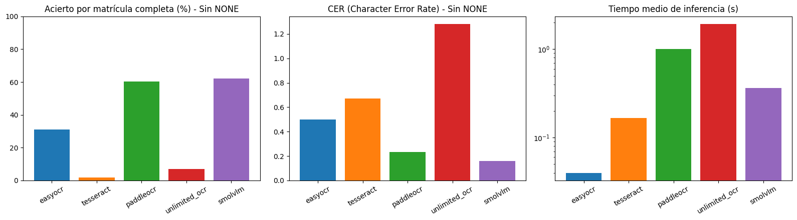
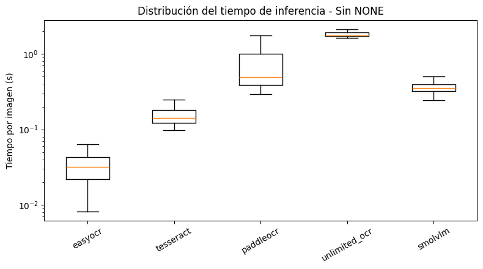
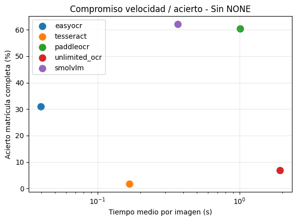

# Autores
[Ubay Antonio Batista Santana](https://github.com/UbayBatista)<br>
[Ángel Sergio Reyes Guedes](https://github.com/asergiorg)

# Trabajo realizado

Para el desarrollo de esta práctica se optó por dividir el trabajo en dos líneas independientes de desarrollo para optimizar el tiempo de trabajo.

## Entrenamiento de los modelos

### Curado del dataset

En primer lugar, se entrenó el modelo YOLO con el dataset generado por los compañeros, no obstante, fue necesario eliminar imágenes mal etiquetadas y que se habían rotado, por lo que se le pidió a la IA un script para hacer esto. Una vez limpio el dataset, se tuvo que transformar a la estructura de entrenamiento que esperaban los modelos, por lo que, con el fin de hacerlo de forma aleatoria, se le solicitó a la IA otro script para que la estructura del dataset fuera la siguiente:
<div align="center">
<div style="text-align: left; display: inline-block;">

```text 
dataset
   ├───test
   │   ├───images
   │   └───labels
   ├───train
   │   ├───images
   │   └───labels
   └───val
       ├───images
       └───labels
```

</div>
</div>

Para el aprendizaje de YOLO, se optó por mantener el dataset sin modificar, ya que el entrenamiento es ligero. No obstante, a la hora de entrenar el modelo de RTDTR se presentó un gran retardo en el entrenamiento por el coste de lectura de las imágenes, por lo que, con otro script generado con Inteligencia Artificial se redujo el tamaño de las imágenes y se ubicó en una posición diferente, en la que el retardo era menor.

### Configuración del entrenamiento de los modelos

Una vez entrenado el modelo de YOLO, se hizo lo mismo con el modelo de RTDETR, que supuso un reto mayor porque la resolución con la que se entrenaba no permitía que el modelo lograra detectar apenas matrículas pequeñas, por lo que fue necesario modificarlo. Asimismo, por problemas con versiones de cuda y pytorch, fue necesario modificar el tipo de objetos equivalentes a nuevas versiones. 

---

Una vez estaban los modelos ya entrenados, con el fin de tener un código más sencillo y sin repeticiones, se optó por usar únicamente un modelo de YOLO para la detección de vehículos, ya que el comportamiento en las detecciones es diferente. Con esto, se divide el proceso en 3 partes: la primera, detección de vehículos y personas; la segunda, detección de matrículas mediante los modelos entrenados; y, por último, la extracción de texto con OCR:

~~~python
csv_file = open(out_csv, "w", newline="", encoding="utf-8")
csv_writer = csv.writer(csv_file)
csv_writer.writerow(["fotograma", "tipo_objeto", "confianza", "identificador_tracking",
                        "x1", "y1", "x2", "y2", "matrícula_en_su_caso", "confianza",
                        "mx1", "my1", "mx2", "my2", "texto_matricula"])

results = vehicle_model.track(source=VIDEO_PATH, stream=True, persist=True,
                                classes=CLASSES, imgsz=IMGSZ, verbose=False)

t_total = time.perf_counter()
frame_idx = 0
for r in results:
    orig = r.orig_img
    oh, ow = orig.shape[:2]

    frame = cv2.resize(r.plot(), (OUT_WIDTH, out_h))

    for box in r.boxes:
        if box.id is None:
            continue

        name = vehicle_model.names[int(box.cls[0])]
        track_id = int(box.id[0])
        conf = float(box.conf[0])
        x1, y1, x2, y2 = map(int, box.xyxy[0])
        x1, y1, x2, y2 = max(x1, 0), max(y1, 0), min(x2, ow), min(y2, oh)

        plate_label, plate_conf = "", ""
        mx1 = my1 = mx2 = my2 = ""
        plate_text = ""

        if name in VEHICLES:
            vehicle_ids.add(track_id)
            vehicle_crop = orig[y1:y2, x1:x2]

            if vehicle_crop.size == 0:
                continue

            found = get_best_plate(plates_detector, vehicle_crop, yolo)
            
            if found is not None:
                px1, py1, px2, py2, pconf = found

                # Coordenadas de la matrícula respecto al fotograma completo
                mx1, my1, mx2, my2 = x1 + px1, y1 + py1, x1 + px2, y1 + py2
                plate_label, plate_conf = "plate", pconf

                # Colo leemos con OCR de vez en cuando para no ir lentos
                due = frame_idx - last_ocr_frame.get(track_id, -TIME_BETWEEN_OCR) >= TIME_BETWEEN_OCR
                if due:
                    bw, bh = mx2 - mx1, my2 - my1
                    cx1 = max(int(mx1 - bw * PADDING), 0)
                    cy1 = max(int(my1 - bh * PADDING), 0)
                    cx2 = min(int(mx2 + bw * PADDING), ow)
                    cy2 = min(int(my2 + bh * PADDING), oh)
                    plate_crop = orig[cy1:cy2, cx1:cx2]

                    if plate_crop.size > 0:
                        t0 = time.perf_counter()
                        try:
                            text, _ = ocr.read(plate_crop)
                        except Exception as e:
                            text = ""
                            print(f"  fallo de OCR en fotograma {frame_idx}: {e}")
                        ocr_time += time.perf_counter() - t0
                        ocr_calls += 1

                        text = clean_text(text)
                        last_ocr_frame[track_id] = frame_idx

                        # guardamos la lectura si es plausible y la matrícula se vio mejor
                        prev = best_reading.get(track_id)
                        if len(text) >= MIN_PLATE_CHARS and (prev is None or pconf > prev["det_conf"]):
                            best_reading[track_id] = {"text": text, "det_conf": pconf}

                # dibujamos la caja de la matrícula en el vídeo de salida
                cv2.rectangle(frame, (int(mx1 * scale), int(my1 * scale)),
                                (int(mx2 * scale), int(my2 * scale)), (0, 0, 255), 2)

        # texto leído encima del vehículo (si ya tenemos alguno)
        if track_id in best_reading:
            plate_text = best_reading[track_id]["text"]
            tx, ty = int(x1 * scale), int(y2 * scale) + 22
            (tw, th), _ = cv2.getTextSize(plate_text, cv2.FONT_HERSHEY_SIMPLEX, 0.8, 2)
            cv2.rectangle(frame, (tx, ty - th - 6), (tx + tw + 6, ty + 6), (0, 0, 0), -1)
            cv2.putText(frame, plate_text, (tx + 3, ty),
                        cv2.FONT_HERSHEY_SIMPLEX, 0.8, (0, 255, 255), 2)
                

        elif name == "person":
            person_ids.add(track_id)

        csv_writer.writerow([frame_idx, name, conf, track_id, x1, y1, x2, y2,
                                         plate_label, plate_conf, mx1, my1, mx2, my2, plate_text])

    # contadores y nombre del OCR usado
    cv2.rectangle(frame, (10, 10), (280, 90), (0, 0, 0), -1)
    cv2.putText(frame, f"Vehiculos: {len(vehicle_ids)}", (20, 45),
                cv2.FONT_HERSHEY_SIMPLEX, 0.8, (0, 255, 0), 2)
    cv2.putText(frame, f"Personas: {len(person_ids)}", (20, 78),
                cv2.FONT_HERSHEY_SIMPLEX, 0.8, (0, 255, 255), 2)
    cv2.putText(frame, f"OCR: {OCR_NAME}", (OUT_WIDTH - 300, 35),
                cv2.FONT_HERSHEY_SIMPLEX, 0.8, (255, 255, 255), 2)

    if writer:
        writer.write(frame)

    if SHOW:
        cv2.imshow("Tracking", frame)
        if cv2.waitKey(1) & 0xFF == ord("q"):
            break

    frame_idx += 1

csv_file.close()

if writer:
    writer.release()
if SHOW:
    cv2.destroyAllWindows()
~~~

Obteniendo los siguientes resultados:

## Resultados

[▶️ Resultado YOLO - EASYOCR](https://drive.google.com/file/d/1Di-8jVlpbxH042QHuoxX0y4h7lUif78a/view?usp=sharing)
[▶️ Resultado YOLO - PADDLEOCR](https://drive.google.com/file/d/1bMLKCrxbeiaapeeoL2m7UNVo70PSGJL_/view?usp=sharing)
[▶️ Resultado YOLO - SMOLVLM](https://drive.google.com/file/d/1O3H5TDYVm-2VxM4PnQJ6Dh6B2Le8r44C/view?usp=sharing)
[▶️ Resultado YOLO - TESSERACT](https://drive.google.com/file/d/1fZUz4pJS6ING7YOKZtPmiS2186I8MWVY/view?usp=sharing)
[▶️ Resultado YOLO - UNLIMITED_OCR](https://drive.google.com/file/d/1n8dT2LUdIIlnQcemotFo_fLEA22Q9WC8/view?usp=sharing)
[▶️ Resultado RTDETR - EASYOCR](https://drive.google.com/file/d/1KO-RuL9BWq-3eewwzEgM-kuG-DtTm1Gf/view?usp=sharing)
[▶️ Resultado RTDETR - PADDLEOCR](https://drive.google.com/file/d/1HPwuT6GFyfThueyIc-n21tDj8M4yEaCj/view?usp=sharing)
[▶️ Resultado RTDETR - SMOLVLM](https://drive.google.com/file/d/1ioNBCrpUE_3f0vlAj4ZXRhFNpbEUEoJv/view?usp=sharing)
[▶️ Resultado RTDETR - TESSERACT](https://drive.google.com/file/d/1HE9qvDKWmOsnl3Pe3Dk7_fUWoJzPQT5k/view?usp=sharing)
[▶️ Resultado RTDETR - UNLIMITED_OCR](https://drive.google.com/file/d/1lG-JuXAcN0zg4OKJnkSAh_fTR5lV7JE0/view?usp=sharing)

## Comparativa de los modelos de OCR

El enunciado pide comparar un OCR clásico con un VLM. Hemos ampliado la comparativa a cinco modelos para tener más puntos de referencia: Tesseract,, EasyOCR y PaddleOCR como OCRs Clásicos, y Unlimited-OCR y SmolVLM como modelos de visión y lenguaje (VLMs). Los cinco se prueban con las mismas imágenes y en las mismas condiciones, salvo el dispositivo de ejecución (ver limitaciones), y se comparan por tiempo de inferencia y tasa de acierto.

Ficheros que intervienen:

| Fichero | Contenido |
|---|---|
| `ocr_models.py` | Un envoltorio por modelo, todos con la misma interfaz |
| `benchmark_ocr.ipynb` | Preparación de la muestra, benchmark, métricas y gráficas |
| `video_pipeline_ocr.py` | Pipeline del vídeo de test con el OCR integrado |

### Implementación

#### Modelos evaluados

| Modelo | Tipo | Librería | Dispositivo en la prueba |
|---|---|---|---|
| Tesseract | OCR clásico | `pytesseract` | CPU |
| EasyOCR | OCR clásico | `easyocr` | GPU |
| PaddleOCR | OCR clásico| `paddleocr` | CPU |
| Unlimited-OCR | VLM (`baidu/Unlimited-OCR`) | `transformers` | GPU |
| SmolVLM | VLM (`HuggingFaceTB/SmolVLM-Instruct`) | `transformers` | GPU |

Tesseract y PaddleOCR se ejecutaron en CPU. Tesseract no tiene versión para GPU, y en PaddleOCR se instaló la versión de CPU de `paddlepaddle`. Esto afecta a la lectura de los tiempos y se comenta en las limitaciones.

#### Interfaz común

Todos los modelos están en `ocr_models.py` como clases con dos métodos: `load()` carga el modelo y `read(imagen)` devuelve el texto leído y su confianza (o `None` si el modelo no la da). Se crean con `build_model("nombre")`. Gracias a esto, el cuaderno del benchmark y el script del vídeo usan exactamente el mismo código para cada OCR, y la lectura se limpia siempre igual: mayúsculas y solo letras y números (`clean_text`).

#### Configuración de cada modelo

| Modelo | Configuración |
|---|---|
| EasyOCR | `easyocr.Reader(["es"])`. Recibe el recorte directamente. Si detecta varios fragmentos de texto, los une y devuelve la media de sus confianzas. |
| Tesseract | `lang="spa"` y `--psm 7`, que trata la imagen como una sola línea de texto, que es lo que es una matrícula. En Windows hay que indicar la ruta del ejecutable; en Colab se instala con `apt` y ya está en el `PATH`. |
| PaddleOCR | `lang="es"`. En local (versión 2.7.3) se usa `ocr.ocr(..., cls=True)` con `use_angle_cls=True`. En Colab se instaló la versión 3.x, que cambia la API: se usa `predict()` con los modelos `PP-OCRv6_medium_det` y `PP-OCRv6_medium_rec`, y se desactivan la corrección de documento y la orientación de línea porque el recorte ya es una matrícula. La clase detecta la versión instalada y usa la API que corresponde. |
| Unlimited-OCR | Se carga con `AutoModel` y `trust_remote_code=True` en `bfloat16`, igual que en el ejemplo del repositorio del modelo. Prompt `<image>document parsing.` con la configuración *gundam* (`base_size=1024`, `image_size=640`, `crop_mode=True`). El texto se obtiene de la salida de `infer()` o, si solo lo guarda en disco, del fichero generado. Después se eliminan las etiquetas de localización que añade el modelo (`<\|ref\|>`, `<\|det\|>`). |
| SmolVLM | Prompt en inglés: *"Read the license plate in the image. Answer only with the characters of the plate, nothing else."*. Generación determinista (`do_sample=False`) con `max_new_tokens=15`, `float16` en GPU y sin dividir la imagen en trozos (`do_image_splitting=False`) porque la matrícula es pequeña. Solo se decodifican los tokens nuevos, para no incluir el prompt en el texto. |

#### Entornos de ejecución

El proyecto se desarrolló localmente mediante **Visual Studio Code** y un entorno de **Conda** denominado VC_P4. Sin embargo, la ausencia de una GPU dedicada en el equipo de trabajo limitaba significativamente el rendimiento de los modelos de mayor tamaño. Por ello, **la evaluación comparativa se ejecutó íntegramente en Google Colab** utilizando una **GPU T4**. Las diferencias entre ambos entornos de ejecución, especialmente en las versiones de Python y las dependencias instaladas, hicieron necesario adaptar la configuración de **PaddleOCR** para asegurar su correcto funcionamiento.

**Local (Visual Studio Code, Windows, Python 3.9.25)**

```bash
conda create --name VC_P4 python=3.9.5
conda activate VC_P4
pip install ultralytics lap easyocr pytesseract
pip install paddlepaddle==2.6.2 paddleocr==2.7.3
pip install numpy==1.26.4
```

Además hay que instalar el programa Tesseract OCR para Windows con el idioma español (`spa`), desde [UB-Mannheim/tesseract](https://github.com/UB-Mannheim/tesseract/wiki).

| Librería | Versión |
|---|---|
| ultralytics | 8.4.208 |
| torch / torchvision | 2.8.0 / 0.23.0 |
| opencv-python | 4.6.0.66 |
| numpy | 1.26.4 |
| pandas / matplotlib | 2.3.3 / 3.9.4 |
| easyocr | 1.7.2 |
| pytesseract | 0.3.13 |
| paddlepaddle / paddleocr | 2.6.2 / 2.7.3 |
| transformers | 4.57.6 |
| lap | 0.5.14 |
| rapidfuzz | 3.13.0 |
| addict / einops / easydict | 2.4.0 / 0.8.2 / 1.14 |

**Google Colab (Python 3.13.16, GPU Tesla T4)**

```bash
apt-get install -y tesseract-ocr tesseract-ocr-spa
pip install ultralytics easyocr pytesseract rapidfuzz addict einops easydict
pip install paddlepaddle paddleocr
pip install transformers==4.57.1
```

| Librería | Versión |
|---|---|
| torch | 2.14.1+cu130 |
| transformers | 4.57.1 (fijada, es la versión que indica el ejemplo de Unlimited-OCR) |
| huggingface-hub | 0.36.2 (instalada junto con `transformers`) |
| paddlepaddle / paddleocr | última disponible (serie 3.x), sin fijar |
| ultralytics, easyocr, pytesseract, rapidfuzz, addict, einops, easydict | última disponible, sin fijar |
| Tesseract (paquetes `apt`) | `tesseract-ocr` y `tesseract-ocr-spa` (datos de idioma, versión 4.1.0-2) |

En Colab no se pudo usar `paddlepaddle==2.6.2` porque no existe para Python 3.13 (solo hay versiones 3.x). Por eso PaddleOCR usa allí otra API y otros modelos que en local. La instalación genera avisos de incompatibilidad con `gradio` y `diffusers` por la versión de `huggingface-hub`, que no se usan en este proyecto y no afectan a los resultados.

#### Protocolo del experimento

- **Datos.** Los recortes se obtienen de las anotaciones originales del dataset de detección: cada `.json` trae la caja de la matrícula (`rectangle`, con `(x, y)` en el centro y valores normalizados) y su texto (`plate`). Se recorta cada matrícula con un margen del 5 % y se guarda el texto como referencia. En total salen 4 796 matrículas, de las que se sacan los 100 recortes de la muestra.
- **Muestra.** Se eligen 100 recortes al azar con semilla fija (`SEED = 42`), los mismos para los cinco modelos. De ellos, 42 son matrículas ilegibles que el dataset marca con el texto `NONE`. El enunciado pide completar la base de datos con el texto si faltase, pero en estas no hay texto que poner, así que se excluyen de las métricas. Los modelos se ejecutan sobre los 100 recortes y las métricas se calculan sobre los 58 restantes, que son legibles.
- **Entrada.** Todos reciben el mismo recorte como imagen. No se aplica ningún preprocesado propio, solo el que haga cada librería internamente.
- **Texto.** La lectura y el texto real se normalizan igual antes de compararlos (mayúsculas y solo letras y números), así que espacios y guiones no cuentan.
- **Tiempo.** Se mide con `time.perf_counter()` por imagen, sincronizando la GPU antes y después. Antes de medir se hacen 3 lecturas de calentamiento que se descartan. El tiempo incluye leer la imagen y el post-procesado propio de cada modelo. La carga del modelo se mide aparte.
- **Reanudación.** Cada modelo guarda su resultado en un `.csv` (imagen, texto real, lectura, confianza, tiempo), de modo que todas las métricas se calculan después a partir de esos ficheros.

#### Métricas

| Métrica | Qué mide |
|---|---|
| `exact_match` | Fracción de matrículas leídas exactamente igual que la real. Un solo carácter mal ya cuenta como fallo. |
| `CER` | Tasa de error por carácter: distancia de edición entre lo leído y lo real, dividida entre la longitud real, promediada por imagen. 0 es perfecto y puede pasar de 1 si el modelo devuelve más texto del que hay. |
| `char_accuracy` | `1 - CER`, con mínimo 0. |
| `empty_pred_rate` | Fracción de imágenes en las que el modelo no devuelve nada. |
| `mean_time_s`, `median_time_s`, `p95_time_s` | Tiempo de inferencia por imagen: media, mediana y percentil 95. |
| `load_time_s` | Tiempo de carga del modelo. En la primera ejecución incluye la descarga de los pesos. |

### Comparativa

#### Equipo

| Componente | Especificación |
|---|---|
| Plataforma | Google Colab |
| CPU | x86_64, 2 hilos |
| RAM | 13,6 GB |
| GPU | Tesla T4, 15,6 GB de VRAM |
| Python | 3.13.16 |
| PyTorch | 2.14.1+cu130 |

#### Resultados

Resultados sobre las 58 matrículas legibles de la muestra (se excluyen las 42 con etiqueta `NONE`), las mismas para todos los modelos.

| Modelo | Dispositivo | Acierto exacto | CER | Precisión por carácter | Sin lectura | Tiempo medio (s) | Mediana (s) | P95 (s) | Carga (s) |
|---|---|---|---|---|---|---|---|---|---|
| EasyOCR | GPU | 31,0 % | 0,497 | 0,503 | 17,2 % | 0,040 | 0,032 | 0,093 | 13,2 |
| Tesseract | CPU | 1,7 % | 0,672 | 0,328 | 25,9 % | 0,167 | 0,141 | 0,254 | 0,01 |
| PaddleOCR | CPU | 60,3 % | 0,231 | 0,769 | 10,3 % | 1,007 | 0,496 | 2,350 | 32,0 |
| Unlimited-OCR | GPU | 6,9 % | 1,280 | 0,000 | 0 % | 1,931 | 1,769 | 2,669 | 112,7 |
| SmolVLM | GPU | 62,1 % | 0,158 | 0,842 | 0 % | 0,366 | 0,354 | 0,491 | 56,3 |

<br>







<br>

Como referencia, estos son los resultados de la primera ejecución con los 100 recortes, contando `NONE` como si fuera el texto real (ningún modelo puede acertarlos):

| Modelo | Acierto exacto | CER | Tiempo medio (s) |
|---|---|---|---|
| EasyOCR | 18 % | 0,711 | 0,028 |
| Tesseract | 1 % | 0,800 | 0,158 |
| PaddleOCR | 35 % | 0,579 | 0,688 |
| Unlimited-OCR | 4 % | 1,687 | 1,863 |
| SmolVLM | 36 % | 0,629 | 0,346 |

Los aciertos son los mismos en cifras absolutas (por ejemplo, SmolVLM acierta 36 matrículas en ambos casos) y solo cambia el denominador. Los tiempos, en cambio, son menores con los 100 recortes, porque las matrículas ilegibles se procesan más rápido. Por eso la tabla principal, hecha solo con matrículas legibles, representa mejor el caso real.

#### Análisis

- **Acierto.** SmolVLM (62,1 %) y PaddleOCR (60,3 %) son los mejores con diferencia. La distancia entre ellos es de una sola imagen, y con 58 imágenes el margen de error de un porcentaje cercano al 60 % es de unos ±13 puntos, así que no se pueden distinguir en acierto exacto. Sí se separan en CER: SmolVLM tiene 0,158 y PaddleOCR 0,231, es decir, SmolVLM comete menos errores por carácter. EasyOCR queda en 31 %, claramente por debajo de los dos anteriores, y Unlimited-OCR (6,9 %) y Tesseract (1,7 %) casi no aciertan ninguna.

- **Tiempo.** EasyOCR es el más rápido (0,032 s de mediana y 0,040 s de media), unas 10 veces más rápido que SmolVLM. Después van Tesseract (0,141 s de mediana), SmolVLM (0,354 s), PaddleOCR (0,496 s) y, muy por detrás, Unlimited-OCR (1,769 s). La media de PaddleOCR (1,007 s) es el doble de su mediana y su percentil 95 llega a 2,35 s: tiene una cola de imágenes lentas. SmolVLM es más regular, con un percentil 95 de 0,491 s. El diagrama de cajas no dibuja los valores atípicos, por eso el bigote de PaddleOCR llega a unos 1,75 s y no a los 2,35 s de su percentil 95.

- **Compromiso velocidad y acierto.** En la gráfica de dispersión solo EasyOCR y SmolVLM quedan en el frente: ningún otro modelo es a la vez más rápido y más acertado que ellos. PaddleOCR iguala a SmolVLM en acierto exacto pero su tiempo medio es casi 3 veces mayor, y Tesseract y Unlimited-OCR son peores en acierto y no compensan en tiempo.

- **Errores frecuentes.** Muchos fallos son lecturas casi correctas que el acierto exacto cuenta como error. Ejemplos de los resultados: `3082 JVRI` en lugar de `3082JVR` (EasyOCR), `N5291 LYX` en lugar de `5291LYX` (Tesseract) y `4824 JMR E` en lugar de `4824JMR` (PaddleOCR). En los tres hay caracteres sobrantes al principio o al final, probablemente procedentes del borde de la placa o de la banda azul europea. Por eso el CER describe mejor el rendimiento que el acierto exacto.

- **Modelos que no leen.** Entre las matrículas legibles, EasyOCR no devuelve nada en el 17,2 % de los casos, Tesseract en el 25,9 % y PaddleOCR en el 10,3 %, y en esos casos es un fallo real. SmolVLM y Unlimited-OCR devuelven siempre algún texto.

- **Unlimited-OCR.** Es el peor resultado en CER (1,280) y el más lento, con 112 s de carga y unos 6,7 GB de pesos. Un CER superior a 1 indica que de media comete más errores que caracteres tiene la matrícula, lo que apunta a que devuelve textos bastante más largos que ella. Es un modelo para analizar documentos completos (el prompt es `document parsing`) y, en una de las llamadas cuya salida se ve en el registro de ejecución, el modelo marcó el recorte entero como una región de tipo imagen en lugar de leerlo. No hemos probado otros prompts ni `float16`, así que su resultado depende de esa configuración.

#### Prueba sobre el vídeo de test

Se ejecutó también el pipeline completo (detección, seguimiento, detección de matrículas y OCR) sobre el vídeo de test con cada modelo. En los cinco casos hay 2 832 fotogramas, 44 vehículos, 17 personas y exactamente 152 llamadas al OCR, así que las condiciones son idénticas.

| Modelo | Tiempo por llamada (s) | Tiempo total en OCR (s) | Tiempo total del vídeo (s) |
|---|---|---|---|
| EasyOCR | 0,011 | 1,6 | 250,6 |
| Tesseract | 0,143 | 21,8 | 272,7 |
| PaddleOCR | 0,290 | 44,1 | 301,3 |
| SmolVLM | 0,340 | 51,7 | 307,3 |
| Unlimited-OCR | 1,789 | 272,0 | 537,1 |

El orden de velocidad coincide con el del benchmark, aunque los tiempos por llamada no son idénticos (PaddleOCR tarda 0,29 s por llamada en el vídeo y 1,0 s de media en las matrículas legibles del benchmark), porque el tiempo depende del tamaño y del contenido del recorte. Una vez descontado el tiempo del OCR, el resto del pipeline tarda entre 249 y 265 s en todos los casos, así que la elección del OCR hace pasar el vídeo de unos 4 minutos a casi 9. El número de matrículas leídas que reporta el pipeline cuenta los vehículos con una lectura de al menos 4 caracteres, no las que son correctas, por lo que no sirve como medida de acierto.

#### Conclusiones

- **OCR clásico frente a VLM.** SmolVLM acierta el 62,1 % de las matrículas legibles frente al 1,7 % de Tesseract, y su CER es mucho menor (0,158 frente a 0,672). Tesseract es 2,2 veces más rápido en media (0,167 s frente a 0,366 s), pero se ejecutó en CPU y SmolVLM en GPU, así que esa diferencia de tiempo no es una comparación directa. Con matrículas pequeñas, en perspectiva y con baja resolución, el OCR clásico se queda muy corto.
- **Mejor opción general.** SmolVLM ofrece el mejor acierto y el mejor CER con un tiempo razonable (unos 0,35 s por matrícula en GPU). Si lo que importa es la velocidad, EasyOCR es unas 10 veces más rápido (0,040 s) a cambio de la mitad de acierto.
- **PaddleOCR** iguala a SmolVLM en acierto exacto y queda cerca en CER, y lo hace en CPU. Si se ejecutara en GPU es probable que bajara su tiempo, pero no se ha medido.
- **Unlimited-OCR** no es adecuado para este problema tal y como se ha usado: es el más lento, el que más pesa y el que peor CER tiene, con solo un 6,9 % de acierto exacto.
- **Posible mejora.** Muchos errores son caracteres sobrantes en los extremos, por lo que recortar la banda azul o validar la lectura con el formato de las matrículas españolas (cuatro dígitos y tres consonantes) podría subir el acierto de todos los modelos. No se ha probado.

#### Limitaciones

- **Matrículas ilegibles.** Se excluyen de las métricas las 42 de 100 que el dataset marca como `NONE`, así que no se mide qué hace cada modelo ante una matrícula que no se puede leer. SmolVLM y Unlimited-OCR devuelven siempre algún texto, y eso en una aplicación real puede ser un problema que aquí no se evalúa.
- **CPU y GPU.** Tesseract y PaddleOCR se ejecutaron en CPU (2 hilos) y los demás en GPU, así que los tiempos entre los dos grupos no son directamente comparables.
- **Tamaño de la muestra.** Tras excluir las ilegibles quedan 58 imágenes, con un margen de error de unos ±13 puntos en el acierto. Diferencias pequeñas, como la de SmolVLM y PaddleOCR, no son concluyentes.
- **Tiempos de carga.** Incluyen la descarga de pesos en la primera ejecución, por lo que dependen de la red.
- **Prompt y configuración.** Se usó un único prompt por modelo, sin ajustarlo. En SmolVLM y Unlimited-OCR los resultados dependen de él.
- **Versiones.** En Colab varias librerías no se fijaron, así que otra ejecución en otra fecha puede dar resultados algo distintos.

## Aportación de cada miembro del grupo en las tareas realizadas en esta práctica

Sergio: tratado del dataset, detección de vehículos y entrenamiento de los modelos de detección de matrículas
Ubay: extracción de texto con OCR y comparativa de los distintos modelos

# Fuentes

## Conversaciones con la Inteligencia Artificial

Además, hemos utilizado la asistencia de la IA para la elección de las métricas y su explicación en el README. 

- Para generar el script de transformación del dataset: https://claude.ai/share/d1b1dc3a-999c-4254-93c0-e7094c285e25

- Para generar el script de entrenamiento de rtdetr: https://claude.ai/share/e82cfc50-92b0-4a34-a130-ae2f024ffcad

- Para mejorar la precisión del modelo rtdetr: https://chatgpt.com/share/6af77b55-7b80-83ed-ad1b-97f1f5a814cb

- Para generar el visualizador de anotaciones de YOLO: https://claude.ai/share/d719cc26-1b4c-4867-be6a-aa76a4372f53

- Para adaptar el fichero video_pipeline_ocr_rtdetr: https://chatgpt.com/share/6af77a0d-aed8-83ed-991e-c87717906ffc

- Solucionar problemas con los OCR: https://claude.ai/share/2c4f4ced-bcf3-46ec-91c1-a531da554276

