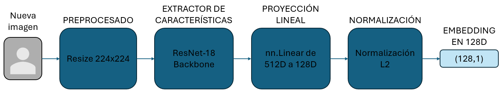
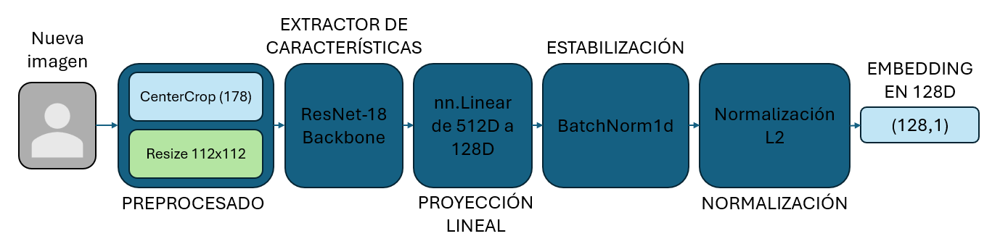
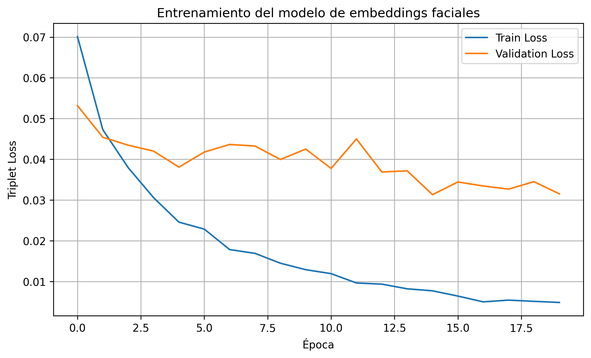
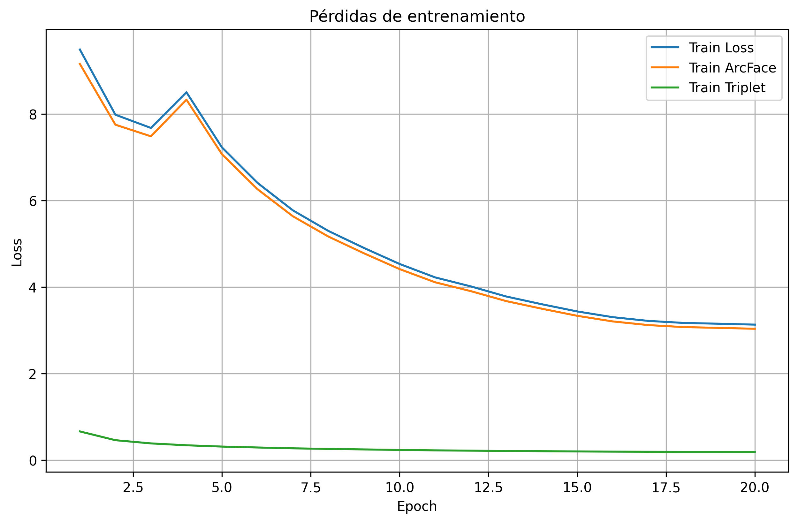

# Autores

- [Ubay Antonio Batista Santana](https://github.com/UbayBatista)
- [Ángel Sergio Reyes Guedes](https://github.com/asergiorg)

# Trabajo realizado

El contenido de esta práctica está compuesto por 3 filtros que utilizan información biométrica, principalmente de la cara. El primero, **desCONOCIDOS**, es un filtro que muestra el famoso con el que compartes mayor parecido; el segundo, **Nose dibujarlo**, permite dibujar usando la nariz y manejar esos dibujos a tu antojo; y el tercero, **Quick Draw**, permite retarse contra un compañero a un duelo al más puro estilo del viejo oeste.

## desCONOCIDOS

Para este filtro, se entrenó un extractor de características faciales a partir de un ResNet18 sobre el dataset CelebA, mediante triplet loss con un espacio vectorial sobre el que proyectar los rostros. Se explica más a detalle este proceso en la comparativa final, ya que se probaron distintos procedimientos para ver cuál daba mejor resultado.

El punto de partida del código es el proporcionado en el repositorio de la asignatura, en el fichero `detectores`. Se optó por el uso de DNN para detectar la cara ya que ofrecía una respuesta muy fluida con menos falsos positivos que los otros modelos presentados. Para el desarrollo de este, se ha realizado un pipeline similar al de la práctica anterior. En primer lugar, el modelo DNN detecta la cara, y se le pasan tanto el frame como el recuadro a la función `get_celeba_crop`, que transforma el recorte original en un recorte más similar al que se puede encontrar en el dataset. Esto, con el fin de mejorar la precisión del modelo. Para ello, se calculan el ancho, altura y el centro del recuadro que el primer modelo ha detectado como cara. Luego, se calculan los nuevos alto y ancho, asignando espacio de sobra y atendiendo a las proporciones de las imágenes del dataset, para evitar que se deforme en caso de redimensionarse. Por último, se transforman las coordenadas para garantizar que se encuentran dentro del frame y se retorna el nuevo crop.

```python
def get_celeba_crop(frame, box):
    H, W = frame.shape[:2]
    x1, y1, x2, y2 = box

    w = x2 - x1
    h = y2 - y1
    cx = x1 + w / 2.0
    cy = y1 + h / 2.0

    new_h = h * 1.65
    new_w = new_h * (178.0 / 218.0)

    cy_shifted = cy - (h * 0.08)

    nx1 = int(max(0, cx - new_w / 2.0))
    ny1 = int(max(0, cy_shifted - new_h / 2.0))
    nx2 = int(min(W, cx + new_w / 2.0))
    ny2 = int(min(H, cy_shifted + new_h / 2.0))

    return frame[ny1:ny2, nx1:nx2], (nx1, ny1, nx2, ny2)
```

Una vez generado el nuevo crop, se le pasa a la función `get_most_similar_famous`. Esta, genera una imagen a partir del recorte, que luego transforma en un tensor que se utilizará para generar el embedding con las características esenciales de la cara en la imagen. Luego, se calcula el producto escalar de un embedding preentrenado, para obtener resultados más rápidos, obteniendo el famoso más parecido. Por último, se configura la ruta y se añade a una cola circular en la que se almacena el resultado de los últimos 20 frames, de forma que la imagen que se muestra corresponde a la ruta con mayor cantidad de votaciones:

```python
def get_most_similar_famous(face):
    face_rgb = cv2.cvtColor(face, cv2.COLOR_BGR2RGB)
    face_image = Image.fromarray(face_rgb)

    face_tensor = transform(face_image).unsqueeze(0).to(device)

    with torch.no_grad():
        query_embedding = model(face_tensor)
        query_embedding = F.normalize(query_embedding, p=2, dim=1)

    similarities = (query_embedding @ gallery_embeddings.T).squeeze(0)

    best_index = torch.argmax(similarities).item()

    route = "." + filenames[best_index]
    votation.append(route)

    most_common_route, _ = Counter(votation).most_common(1)[0]
    return most_common_route
```

Una vez obtenida la ruta, se lee la imagen y se sobrepone en el centro de la parte superior del frame:

```python
overlay = cv2.imread(found)
if overlay is not None:
    h, w = overlay.shape[:2]
    x = max(0, min((W - w) // 2, W - w))
    y = max(0, min(20, H - h))
    frame[y : y + h, x : x + w] = overlay
```

### Comparativa entre modelos

Ambos enfoques entrenan una arquitectura **ResNet-18** para proyectar rostros del dataset CelebA en un espacio vectorial (*embedding*) de 128 dimensiones, pero difieren radicalmente en su formulación matemática y estrategia de aprendizaje:

* **Modelo 1 (Triplet Loss aleatorio):** Utiliza aprendizaje métrico puramente contrastivo sobre ternas (*Anchor*, *Positive*, *Negative*) elegidas al azar, optimizando directamente la distancia euclidiana ($m=0.3$) sin emplear etiquetas de clase globales.

<p align="center">
    
</p>

* **Modelo 2 (ArcFace + Batch-Hard Triplet Loss):** Combina un clasificador angular de margen aditivo ($s=30.0$, $m=0.3$) sobre todas las identidades de entrenamiento con Hard Triplet Loss sobre lotes estructurados, aplicando normalización $L_2$ estricta y recortando la imagen sin distorsión geométrica.

<p align="center">
    
</p>

---

#### 1. Análisis de las curvas de entrenamiento

* **Modelo 1:** La pérdida de entrenamiento (`Train Loss`) cae rápidamente de ~0.070 a menos de 0.005 hacia el final de las 20 épocas. Sin embargo, la pérdida de validación (`Validation Loss`) se estanca en torno a 0.031–0.045 con frecuentes oscilaciones. Esta brecha confirma que la red memoriza los casos fáciles de entrenamiento mientras los tripletes aleatorios dejan de aportar gradientes informativos para generalizar a identidades nuevas.
* **Modelo 2:** La curva muestra una dinámica controlada en dos fases:
  1. **Épocas 1 a 4 (*Warm-up* del margen):** La pérdida total (`Train Loss`) desciende inicialmente de ~9.5 a ~7.7 mientras el margen angular sube progresivamente desde $0.0$, experimentando un repunte esperado hasta ~8.5 en la época 4 al alcanzarse el margen completo.
  2. **Épocas 4 a 20 (Convergencia sostenida):** A partir de ese punto, tanto la componente angular (`Train ArcFace`, que cae de ~8.3 a ~3.05) como la componente local (`Train Triplet`, que baja suavemente de ~0.68 a ~0.19) descienden de forma monótona y sin sobreajuste abrupto, permitiendo al modelo seguir refinando la separación hasta la época 18.

<p align="center">
    
    
</p>

---

#### 2. Comparativa cuantitativa de resultados

Al cruzar los registros finales de `evaluation_metrics.csv` y `evaluation_metrics_arcface.csv`, el modelo híbrido triplica la capacidad de identificación exacta (**Recall@1**):

| Métrica / Parámetro | Modelo 1 (Triplet aleatorio) | Modelo 2 (ArcFace + Batch-Hard) | Diferencia / Impacto |
| :--- | :---: | :---: | :---: |
| **Mejor época** | 15 | 18 | Mayor aprovechamiento del entrenamiento |
| **Recall@1** | **16.10 %** (`0.1610`) | **49.24 %** (`0.4924`) | **+33.14 puntos** (3.06× superior) |
| **Recall@5** | **33.50 %** (`0.3350`) | **66.24 %** (`0.6624`) | **+32.74 puntos** (1.98× superior) |
| **Recall@10** | **41.40 %** (`0.4140`) | **73.16 %** (`0.7316`) | **+31.76 puntos** (1.77× superior) |
| **Triplet Accuracy** | 96.06 % (`0.9606`) | 97.46 % (`0.9746`) | +1.40 puntos |
| **Verificación (Acc / AUC)** | *No medida* | **92.56 %** / **0.9736** | Excelente separabilidad 1:1 |
| **Separación del espacio** | Dist. pos: `0.556` / neg: `1.276` | Sim. pos: `0.449` / neg: `0.005` | Pares negativos casi ortogonales ($\approx 0$) |
| **Protocolo de evaluación** | 1 000 queries / galería 5 000 | 5 000 queries / galería 2 031 | Evaluación más amplia y representativa |

*(Nota sobre el protocolo: en el Modelo 1 se evaluó sobre 1 000 consultas frente a 5 000 imágenes de galería, mientras que en el Modelo 2 se emplearon 5 000 consultas frente a 2 031 identidades únicas en galería; aun considerando el distinto tamaño de galería, la ganancia de +33 puntos en Recall@1 refleja una mejora estructural sustancial en la discriminación fina).*

---

#### 3. Conclusiones clave

1. **Engaño de la *Triplet Accuracy*:** Aunque el Modelo 1 alcanza un **96.06 %** de *Triplet Accuracy* (acierta al comparar un par positivo contra un único negativo aleatorio), su **Recall@1 cae al 16.10 %** al buscar a una persona entre miles de candidatos. Comparar contra un negativo al azar es demasiado fácil y no garantiza fronteras de decisión compactas, ya que el modelo acaba aprendiendo características superficiales no distintivas.
2. **Eficacia de la geometría angular:** El Modelo 2 logra separar identidades distintas de forma notoria (similitud del coseno media negativa de **`0.0046`** frente a **`0.4494`** en positivos), logrando elevar el **Recall@1 al 49.24 %** y el **Recall@10 al 73.16 %** con una precisión de verificación 1:1 del **92.56 %** y un `AUC` de 0.9736.
3. **Organización:** la forma en que se configuran los tripletes para el entrenamiento afecta notoriamente al resultado que produce cualquier extractor de características.

---

#### 4. Aspectos a mejorar para obtener un mejor modelo

Pese a que los resultados obtenidos con el segundo modelo fueron satisfactorios para el objetivo que se pretendía alcanzar, el resultado habría experimentado una mejora considerable si se hubieran aplicado los siguientes cambios:

1. **Curado del dataset:** el dataset utilizado posee una gran cantidad de imágenes, entre las que es frecuente encontrar imágenes mal etiquetadas, con posturas extremas u oclusión, por lo que se dificulta la identificación de algunas identidades.
2. **Enfoque del entrenamiento**: para evitar que el entorno sea determinante en el resultado de la imagen, sería ideal que, previo al entrenamiento, se extrajeran únicamente las caras de los famosos para buscar parecidos a partir de estas.

## Nose dibujarlo

La premisa del filtro es la siguiente: decórate a ti y a tu entorno mediante dibujos que tú mismo puedes hacer, no obstante, para hacerlo más divertido, el único pincel será tu nariz.

Para el desarrollo de este filtro, se ha partido del código base proporcionado en el repositorio de la asignatura. Se ha usado únicamente mediapipe, por lo que fue necesario descargar las opciones básicas de los modelos de mano y cara. A partir de este código, y con las opciones y landmarkers creados, se separó la lógica en dos bloques diferentes:

### 1. Dibujando:

Para acceder a este modo se debe mantener los ojos cerrados durante 18 frames consecutivos, saliendo de este de la misma forma. Por lo que fue necesario solicitar a la Inteligencia Artificial una función que detectara el parpadeo a partir de la relación entre la distancia vertical entre los párpados y la anchura del ojo.

```python
def calculate_ear(landmarks, indexes, w, h):
    # Convertir coordenadas normalizadas a píxeles
    pts = np.array([(landmarks[i].x * w, landmarks[i].y * h) for i in indexes])

    # Distancias verticales
    v1 = np.linalg.norm(pts[1] - pts[5])
    v2 = np.linalg.norm(pts[2] - pts[4])

    # Distancia horizontal
    horiz = np.linalg.norm(pts[0] - pts[3])

    return (v1 + v2) / (2.0 * horiz)
```

Una vez dentro del modo, se sigue el landmark de la nariz para dibujar trazos que se almacenan vectorialmente, como una lista de puntos, `current_line`, que se grafica en cada frame:

```python
cv2.polylines(frame, [np.array(current_line, dtype=np.int32)],
                          isClosed=False, color=(0, 255, 0), thickness=5)
```

Cuando el usuario termina de dibujar, saliendo del modo dibujo, se almacena este dibujo en `lines`, que se muestra también con una función similar a la anterior.

### 2. Gestión de las manos

Cuando no se está dibujando, el usuario puede mover los dibujos, si existen, pudiendo arrastrarlos por la pantalla y colocárselos como accesorios en la cara. Para ello, fue necesario, a partir del landmark de la mano, separar en los landmarks de los dedos índice y pulgar, para el movimiento de pinzar '🤏', la muñeca y los nudillos, para conocer el tamaño de la palma de la mano. Con estos valores, se calcula la distancia euclídea entre los dedos y entre muñeca y nudillos, para obtener la distancia normalizada entre los dedos con respecto al tamaño de la mano, retornando las coordenadas del punto intermedio en el que se 'pellizca' para arrastrar el dibujo, resultando en la siguiente función:

```python
def is_user_grabbing(landmarks, w, h, umbral=GRAB_THRESHOLD):
    thumb = landmarks[4]
    forefinger = landmarks[8]
    wrist = landmarks[0]
    media_base = landmarks[9]

    tip_distance = calculate_distance(thumb, forefinger)
    palm_size = calculate_distance(wrist, media_base)

    if palm_size == 0:
        return None, None, False

    pixel_x = int((thumb.x + forefinger.x) / 2 * w)
    pixel_y = int((thumb.y + forefinger.y) / 2 * h)
    distance = tip_distance / palm_size

    return pixel_x, pixel_y, distance < umbral
```

Cuando el usuario intenta agarrar un trazo, se realiza una búsqueda de la línea más próxima en un radio delimitado, de forma que se retorna el índice de aquella línea cuya distancia euclídea es la menor al punto en que se agarró, si no se encontrara ninguna recta en el radio especificado devolvería `None`:

```python
def nearest_line(x, y, radius=SELECT_RADIUS):
    for i, line in enumerate(lines):
        # Distancia euclidiana de (x, y) a todos los puntos del trazo
        distancias = np.linalg.norm(line - np.array([x, y]), axis=1)
        if np.min(distancias) < radius:
            return i
    return None
```

Una vez capturada la línea, se considera como línea posible a usar como accesorio, por lo que se almacena en el diccionario `anchors`, que contiene los trazos que siguen a la cara del usuario. Luego, se actualiza la posición y se desplaza el dibujo junto con la mano. Por último, cuando el usuario suelta el dibujo que estaba arrastrando, se llama a la función `release_line`, generada por la IA, que, si está cerca de la cara, en este caso el parámetro frame, lo ancla a la cara aplicando las transformaciones necesarias, como rotaciones, que aplica a partir de la función `rotation`, que genera matrices 2x2 de rotación, o transformando a local las coordenadas mediante la función `to_local`:

```python
def release_line(i, frame):
    if i is None or i >= len(lines) or frame is None:
        return
    origin, scale, _ = frame
    d = np.min(np.linalg.norm(lines[i] - origin, axis=1))
    if d < ATTACH_DISTANCE * scale:
        anchors[i] = to_local(lines[i].astype(np.float64), frame)

def rotation(angle):
    c, s = math.cos(angle), math.sin(angle)
    return np.array([[c, -s], [s, c]])

def to_local(points, frame):
    origin, scale, angle = frame
    return ((points - origin) @ rotation(angle)) / scale
```

Por último, con la asociación de los objetos a la cara es necesario que se actualice la posición en cada frame para ubicarla sobre la cara, por lo que se crea la variable `frame_ref` a partir de la función `face_frame`, que genera los resultados que utilizan las funciones anteriores, y la próxima. En esta función, se calcula, a partir de los landmarks de las comisuras externas de los ojos, la distancia entre los ojos, que es la escala, el origen, que es el punto medio entre el vector que une los ojos, aproximadamente el puente de la nariz, y el ángulo de este vector, para aplicar las transformaciones correspondientes en `to_local` y en `to_world`.

```python
def face_frame(face, w, h):
    a, b = face[33], face[263]
    pa = np.array([a.x * w, a.y * h])
    pb = np.array([b.x * w, b.y * h])
    v = pb - pa
    scale = np.linalg.norm(v)
    if scale < 1e-6:
        return None
    return (pa + pb) / 2.0, scale, math.atan2(v[1], v[0])

def to_world(local, frame):
    origin, scale, angle = frame
    return origin + scale * (local @ rotation(angle).T)
```

Con estas funciones, en cada frame se actualiza la posición de los dibujos anclados a la cara de la siguiente forma:

```python
lines[i] = to_world(local, frame_ref).astype(np.int32)
```

## Quick Draw

Un duelo del viejo oeste para dos jugadores que comparten ordenador y cámara. Cada jugador lleva un sombrero y un bigote de cowboy dibujados sobre su cara y, tras la señal de "¡FUEGO!", gana la ronda quien antes haga el gesto indicado. El duelo es al mejor de 3 rondas (gana quien llegue primero a 2 puntos). Todo el filtro está en el cuaderno `VC_P5_quickdraw.ipynb`.

### 1. Modos de juego y controles

En el menú se elige el modo pulsando su número:

| Tecla | Modo | Gesto de la ronda |
| :---: | :--- | :--- |
| **1** | Solo beso | Morritos |
| **2** | Solo cejas | Cejas levantadas |
| **3** | Solo pistola | Mano en forma de pistola (índice apuntando) |
| **4** | Aleatorio, avisando antes | Aleatorio. Se anuncia antes de la espera |
| **5** | Aleatorio, avisando al disparar | Aleatorio. Solo se revela junto al "¡FUEGO!" |

Durante el juego: **R** revancha (al terminar el duelo), **M** vuelve al menú, **L** muestra u oculta los puntos de detección y **Esc** cierra la ventana.

Reglas de cada ronda:

* Si alguien hace el gesto antes del "¡FUEGO!" (en la fase "Prepárense...") es una **salida en falso**: pierde la ronda y el rival suma un punto. Si lo hacen los dos, se repite la ronda.
* Reaccionar en menos de 0.10 s tras el "¡FUEGO!" también se considera anticipación, porque es prácticamente imposible reaccionar tan rápido.
* Si los dos empiezan el gesto en el mismo fotograma, hay **empate** y se repite la ronda. Lo mismo ocurre si nadie dispara en 5 s.
* Si un jugador sale de la cámara durante el anuncio o la espera, la ronda se pausa hasta que vuelve.

### 2. Detección de los jugadores

El frame se voltea horizontalmente (efecto espejo) antes de detectar, y la detección se hace sobre la imagen limpia, antes de aplicar el filtro de color. Se utilizan dos modelos de MediaPipe en modo `VIDEO`:

* **`FaceLandmarker`**: hasta 2 caras, con 478 landmarks y los 52 *blendshapes* (coeficientes de 0 a 1 que indican cuánto está activo cada gesto facial, como `mouthPucker` o `browInnerUp`).
* **`HandLandmarker`**: hasta 4 manos (cada jugador podría enseñar las dos), con 21 landmarks en píxeles para dibujar y otros 21 en coordenadas 3D reales para medir los dedos sin depender de la orientación de la mano.

Los jugadores se identifican por su posición: las caras se ordenan por la coordenada x de la punta de la nariz, de modo que **J1 es la cara de la izquierda y J2 la de la derecha**.

```python
# Se asigna el jugador por la posición horizontal de la nariz
faces.sort(key=lambda f: f["points"][LM_NOSE_TIP][0])
```

Cada mano se asigna al jugador cuya nariz esté más cerca en horizontal de la muñeca. Se compara solo la x porque la y de la muñeca cambia mucho al jugar y no distingue a un jugador del otro:

```python
wrist_x = hand["points"][0][0]
distances = [abs(wrist_x - face["points"][LM_NOSE_TIP][0]) for face in faces]
assigned[int(np.argmin(distances))].append(hand)
```

El resultado es una lista de jugadores `{"face": ..., "hands": [...]}` con la que trabaja el resto del código.

### 3. Sombrero y bigote

Ambos accesorios se dibujan por código con OpenCV, una sola vez al arrancar, como imágenes con canal alfa (transparencia): polígonos suavizados con el algoritmo de Chaikin y contorno oscuro para dar un aspecto de dibujo animado. En cada frame se transforman y se superponen a la imagen:

* **Posición**: el sombrero se ancla a la frente y el bigote entre la base de la nariz y el labio superior.
* **Inclinación**: se calcula con la recta que une las comisuras externas de los ojos.
* **Tamaño**: proporcional al ancho de la cara, medido en **3D** (x e y, junto con la profundidad z, escalada con el ancho de la imagen para que tenga las mismas unidades que x). Así el sombrero no se encoge al girar la cabeza.

```python
left = np.array([*pts[LM_FACE_LEFT], depth[LM_FACE_LEFT]])
right = np.array([*pts[LM_FACE_RIGHT], depth[LM_FACE_RIGHT]])
width = np.linalg.norm(right - left)
```

Para superponer cada accesorio sobre la imagen de la cámara se tiene en cuenta su transparencia (canal alfa): donde el dibujo es opaco se ve el sombrero o el bigote, donde es transparente se ve la cámara y en los bordes se combinan los dos colores, lo que evita bordes dentados. Este cálculo no se hace sobre los 640×480 píxeles del frame, sino solo dentro del rectángulo que encierra al sprite ya girado y escalado, lo que reduce el coste de dibujar los accesorios.

### 4. Gestos

Los gestos de la cara se miden con *blendshapes* y un umbral, ajustado con valores medidos en una cámara real:

| Gesto | Blendshape | En reposo | Haciendo el gesto | Umbral |
| :--- | :--- | :---: | :---: | :---: |
| Beso | `mouthPucker` | hasta 0.55 | 0.99 - 1.00 | 0.80 |
| Cejas levantadas | `browInnerUp` | 0.10 - 0.20 | 0.80 - 0.90 | 0.50 |

```python
def is_kiss(player):
    return player["face"]["blendshapes"]["mouthPucker"] > KISS_THRESHOLD

def is_brows_up(player):
    return player["face"]["blendshapes"]["browInnerUp"] > BROWS_UP_THRESHOLD
```

Se probaron y descartaron el guiño (sus valores se solapaban con los de un parpadeo normal), las mejillas (no se detectaba nada) y la boca abierta (no resultaba divertida).

La **pistola** necesita medir los dedos, y ninguna medida funcionaba por sí sola en todas las orientaciones de la mano, así que se combinan dos con las coordenadas 3D reales:

* **`finger_curl`** (mano de frente): recorrido de los tres tramos del dedo dividido por la distancia directa entre su base y su punta. Un dedo recto da cerca de 1 y uno doblado, bastante más.
* **`finger_ratios`** (mano de lado): distancia de la punta a la muñeca dividida por la de la articulación media a la muñeca. Un dedo estirado supera 1 y uno doblado queda por debajo.

```python
def is_pistol(player):
    others = ("middle", "ring", "pinky")

    for hand in player["hands"]:
        curl = finger_curl(hand)
        ratio = finger_ratios(hand)

        # De frente: el índice está recto y los otros tres claramente doblados
        front = (curl["index"] < FINGER_STRAIGHT_MAX
                 and all(curl[name] > FINGER_CURLED_MIN for name in others))

        # De lado: el índice se aleja de la muñeca mucho más que el resto
        side = (ratio["index"] > FINGER_EXTENDED_RATIO
                and ratio["index"] - max(ratio[name] for name in others) > POINTING_MARGIN)

        if front or side:
            return True
    return False
```

Para evitar falsos positivos de un solo frame, la clase `GestureState` exige que el gesto se mantenga 2 frames seguidos. Aun así, devuelve el instante en que el gesto **empezó**, no el de su confirmación, de modo que esos frames de comprobación no penalizan el tiempo de reacción.

### 5. Lógica del juego

La clase `Game` es una máquina de estados que se actualiza en cada frame:

| Estado | Qué ocurre | Termina cuando |
| :--- | :--- | :--- |
| **Menú** | Se elige el modo | Se pulsa 1-5 |
| **Anuncio** (solo modo 4) | Se muestra el gesto de la ronda | Pasan 2.5 s |
| **Espera** | "Prepárense...", entre 2.5 y 6 s aleatorios. Hacer el gesto aquí es salida en falso | Acaba la espera (pasa a ¡Fuego!) o hay salida en falso (pasa a Resultado) |
| **¡Fuego!** | Se mide quién empieza antes el gesto | Alguien dispara, hay anticipación, empate o pasan 5 s |
| **Resultado** | Se muestra el ganador y el tiempo de reacción durante 3 s | Siguiente ronda o fin del duelo |
| **Fin del duelo** | Gana quien llega a 2 puntos | R (revancha) o M (menú) |

La decisión del estado "¡Fuego!" separa a quienes se anticipan de quienes disparan y gana el instante de inicio más temprano:

```python
limit = self.draw_time + MIN_REACTION_SECONDS
cheaters = [i for i in range(2) if fired[i] is not None and fired[i] < limit]
shooters = [i for i in range(2) if fired[i] is not None and fired[i] >= limit]
```

### 6. Ambientación y efectos

Una vez hecha la detección se aplica un filtro de ambiente: tono **sepia** mezclado con la imagen original y esquinas oscurecidas (viñeteado), más partículas de **polvo** arrastradas por el viento y una **bola de paja** que cruza la pantalla de vez en cuando.

```python
sepia = cv2.transform(frame, SEPIA_MATRIX)
mixed = cv2.addWeighted(frame, 1 - SEPIA_STRENGTH, sepia, SEPIA_STRENGTH, 0)
return cv2.multiply(mixed, self.vignette, scale=1 / 255)
```

Al ganar una ronda se produce un destello blanco y una explosión con el texto "¡BANG!" junto a la cara de quien ha disparado, y el sombrero del perdedor sale despedido con gravedad y rotación. Quien pierde el duelo se queda sin sombrero en la pantalla final. Cuando hay una salida en falso, el sombrero de quien se adelanta (o de los dos, si ambos lo hacen) también sale despedido, pero sin explosión.

### 7. Sonido

Los sonidos se sintetizan por código con NumPy al arrancar, se guardan como WAV en la carpeta temporal del sistema y se reproducen con `winsound`, que solo permite un sonido a la vez (cada momento del juego tiene uno propio):

| Momento | Sonido |
| :--- | :--- |
| Anuncio del gesto (modo 4) | Dos notas agudas |
| Espera | Dos clics de revólver |
| ¡Fuego! | Campana metálica |
| Gana una ronda | Disparo (chasquido, estampido y golpe grave) |
| Salida en falso | Zumbador descendente |
| Empate o nadie dispara | Dos notas suaves que bajan |
| Fin del duelo | Fanfarria |
| Menú y, tras la fanfarria, fin del duelo | Música de fondo en bucle |

La **música de fondo** está compuesta para el filtro: un bajo al galope, un trémolo de guitarra (cuerda pulsada con el algoritmo de Karplus-Strong) y una melodía silbada. Al empezar una ronda se corta sola, porque cualquier otro sonido sustituye al anterior.

### 8. Requisitos y compatibilidad

El cuaderno necesita `face_landmarker.task` y `hand_landmarker.task` en su carpeta, que ya están en la estructura indicada más abajo. Se ejecutan las celdas en orden y la última abre la ventana "Quick Draw".

Se ha desarrollado y probado en **Windows**. En otros sistemas operativos debería poder ejecutarse con pequeños cambios:

* **Fuente**: el texto usa la fuente Arial de Windows (`FONT_PATH = "C:/Windows/Fonts/arial.ttf"`). Hay que sustituir esa ruta por la de una fuente `.ttf` disponible en el sistema.
* **Cámara**: se abre con `cv2.VideoCapture(CAMERA_INDEX, cv2.CAP_DSHOW)`, un modo exclusivo de Windows. En otros sistemas basta con `cv2.VideoCapture(CAMERA_INDEX)`.
* **Sonido**: depende de `winsound`, que solo existe en Windows. Si no está disponible, el juego funciona igualmente, pero sin efectos ni música.

# Demostraciones

## desCONOCIDOS

https://github.com/user-attachments/assets/1cf3d44c-83be-4d6d-955f-3a5d0fe71965

## Nose dibujarlo

https://github.com/user-attachments/assets/ec981a31-1ab0-4c30-b567-d3b3c8a61f34

## Quick Draw

[▶ Demo del filtro Quick Draw](https://drive.google.com/file/d/1EyfbkDIsNKDB6spDms9ZR-MnbyLZfGqv/view?usp=sharing)

# Trabajo individual de cada miembro

- desCONOCIDOS: Sergio
- Nose dibujarlo: Sergio
- Quick Draw: Ubay
- README: Ubay y Sergio

# Ejecución del cuaderno

## Comandos para crear el environment con lo necesario:

```bash
conda env create -f environments.yml
conda activate VC_P5
```

Para poder ejecutar el cuaderno, el directorio debe tener la siguiente estructura:

```
P5
 ├── best_face_embedding_resnet18_arcface.pth
 ├── best_face_embedding_resnet18.pth
 ├── content
 │   └── datos
 │       └── dataset
 │           ├── identity_CelebA.txt
 │           └── img_align_celeba
 ├── data
 ├── deploy.prototxt.txt
 ├── environments.yml
 ├── face_landmarker.task
 ├── gallery_embeddings_arcface.pt
 ├── gallery_embeddings.pt
 ├── hand_landmarker.task
 ├── images
 ├── README.md
 ├── res10_300x300_ssd_iter_140000.caffemodel
 ├── VC_P5.ipynb
 └── VC_P5_quickdraw.ipynb
```

# Fuentes

- Enlace al dataset: https://mmlab.ie.cuhk.edu.hk/projects/CelebA.html

## Conversaciones con la IA

- Para sobreponer la imagen del famoso sobre el frame: https://chatgpt.com/share/6b05e067-ece0-83eb-8341-fe86febccd56

- Para extraer la información de los landmarks de la cara en el segundo filtro: https://share.gemini.google/hreKMcZP6LcJ

- Para controlar el parpadeo: https://share.gemini.google/LUzMzPup7coK

- Para anclar los dibujos a las caras: https://claude.ai/share/4d7dd9ed-3fc0-4d70-8aa1-152e76c1f8d9

- Para generar el entrenamiento del primer modelo: https://chatgpt.com/share/6b076451-f7a8-83eb-bead-1603b8875e5f

- Para generar el modelo del segundo entrenamiento: https://claude.ai/share/d8502458-ad75-48f8-adc7-0c6b8e80565d

## Asistencia de herramientas de IA en Quick Draw

He utilizado la IA **como asistente** durante todo el desarrollo de Quick Draw, siempre a partir de especificaciones y peticiones concretas. En lugar de enlazar las conversaciones, detallo en qué consistió su ayuda:

- **Toma de decisiones y diseño**: utilicé la IA para evaluar posibles enfoques de implementación, como los modos de juego, los gestos candidatos, la ambientación o la forma de medir cada gesto, y para analizar la viabilidad técnica de cada uno.
- **Programación**: durante el proyecto se utilizó código generado por la IA a partir de especificaciones y peticiones concretas. Ese código lo revisé, lo comprendí y resolví con ayuda de la IA las dudas que surgieron durante su estudio, como el funcionamiento de los *blendshapes* (con los que se detectan el beso y las cejas) o el cálculo de lo doblado o estirado que está cada dedo (con el que se detecta la pistola). Después lo integré en el cuaderno, lo probé y lo modifiqué cuando fue necesario. Esto incluye la detección y asignación de los jugadores, las reglas de reconocimiento de cada gesto y la lógica del duelo.
- **Calibración de los gestos**: la IA propuso las medidas y los umbrales de partida, y los ajusté con los valores que obtenía al probar los gestos con la cámara. De esas pruebas salieron los gestos finales (beso, cejas y pistola) y el descarte de otros que no funcionaban bien.
- **Gráficos y efectos**: el sombrero, el bigote, el filtro sepia, el polvo, la bola de paja, la explosión y el sombrero que sale volando los generó la IA como código, a partir de mis especificaciones. **No me descargué ninguna imagen ni ningún modelo.**
- **Sonido**: los efectos de sonido y la música de fondo fueron creados por la IA como código, a partir de mis especificaciones sobre qué sonido corresponde a cada momento del juego y el estilo de la música. **No utilicé ningún archivo de audio externo**, por lo que no hay licencias de las que depender.
- **Depuración**: la IA me ayudó a localizar y corregir errores concretos que fui encontrando al probar el filtro, como un *blendshape* inexistente que daba `KeyError`. Para ello le aporté el mensaje de error, capturas y el código actual. También comprobó la lógica del juego con simulaciones antes de que yo la probara con la cámara.
- **Revisión final del código**: optimización de la superposición de los accesorios y búsqueda de errores, código no utilizado y comentarios desactualizados.
- **Documentación**: la IA redactó la explicación de este filtro siguiendo mis especificaciones y bajo mi supervisión. Posteriormente, el texto se revisó y reformuló varias veces hasta alcanzar la redacción final.
